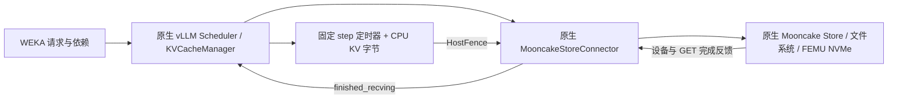

# kv-ssd-sim：无 GPU 的 KV 存储闭环原型

这版直接运行 **vLLM 原生 Scheduler、KVCacheManager、MooncakeStoreConnector，以及 Mooncake 原生磁盘 offload**。不加载模型权重，不执行 forward；使用真实 CPU KV 缓冲区和固定计算等待时间。

默认单盘现可用 `--nand-stats` 同窗口采集 NAND 编程、GC 搬迁、块擦除、页占用率和字节写放大。真实尺寸 K3 两轮样本写入 2,403,700,736 B，实测 WAF 为 1.0000；独立覆写探针已验证非零 GC 和擦除。[阶段 E 的统计与用法](docs/阶段E-NAND统计验收.md)

阶段 D 已完成 K3 单盘布局配对。混放与按类分放各回放同一真实 WEKA 切片一次，每组从磁盘恢复并验证全部 208 个对象。在自然流量窗口中，同时涉及两种载荷的写请求由 65 笔降到 0 笔。[逐字节归因与复现](docs/阶段D-对象到LBA与布局对照.md)

K3 真实尺寸在线存取和 SSD 负载测量已完成。8 GiB 客体、3 GiB FEMU 上对真实 WEKA 两轮做了三次严格对账的独立回放，设备每次写入约 2.24 GiB。[C1 容量与存取验收](docs/阶段C1-K3真实尺寸与容量验收.md) · [C2 负载报告与图表](docs/阶段C2-K3真实尺寸SSD负载报告.md)

SSD 负载阶段 B2 已完成两轮自然回放的流式块采集，并按设备计数验收了请求、轮间与后台尾部。配置、图表及复核命令见[B2 报告](docs/阶段B2-完整采集验收.md)。

已完成的实验、实测数据和测试记录见 [第一版验收报告](docs/验收报告.md)。

按 [Kimi K3＋八卡 B300 仿真实施计划](docs/KimiK3-B300仿真实施计划.md)，已完成 [输入审计](docs/KimiK3-B300步骤1验收报告.md)、[缓存与容量转换](docs/KimiK3-B300步骤2验收报告.md) 和 [步骤 3：真实尺寸分片存取](docs/KimiK3-B300步骤3验收报告.md)。离线复核步骤 3：`.venv/bin/python scripts/check_k3_shard_evidence.py evidence/kimi-k3-step3`。

已补齐可配置 MLA＋KDA 混合状态，见 [混合注意力验收报告](docs/混合注意力验收报告.md)。AIPerf 0.13.0 HTTP 接入已完成，见 [接入与验收](docs/AIPerf接入验收报告.md)；额度后续接脚本见 [使用说明](docs/额度恢复脚本.md)。

**步骤 6 已完成真实 WEKA 两轮的本机缩放对照。** 保留 71,168-token 共享前缀，以 tiny MLA/KDA 和实际 FEMU 各运行三次。第二轮客户端 TTFT 中位数为 10.19 / 11.90 s（40 µs / 2 ms NAND 页读）。另保留一次触发 Mooncake 暂存缓冲区超时的 10 ms 失败样本。[步骤 6 报告与复现命令](docs/KimiK3-B300步骤6验收报告.md)

**步骤 5 已通过自然容量压力验收。** 在 22 请求的原生 replay 中，Mooncake 按内存水位驱逐副本，后续请求从 FEMU 读取 272 KiB，恢复 128 个前缀 tokens。独立缺片探针验证了完整重算。配置、复现命令与宿主水位对照见[步骤 5 报告](docs/KimiK3-B300步骤5验收报告.md)。

**步骤 4 已通过 AIPerf＋FEMU 端到端配对验收。** 客体读取指定的 trace 和模型缓存配置，AIPerf 等待人工冷准备完成后再发送第二个请求。调慢 NAND 读后，Mooncake GET 从 162.1 增至 565.8 ms，客户端原始 TTFT 从 252.1 增至 654.9 ms。此次使用 tiny MLA/KDA，两组各运行一次。复现命令及原始证据见[步骤 4 报告](docs/KimiK3-B300步骤4验收报告.md)。早期客户端计时受冷准备干扰的结果保存在[历史联合验收报告](docs/AIPerf-FEMU联合验收报告.md)。

占位 KV 开销已优化，新的前后对照见 [开销缩减报告](docs/开销缩减报告.md)。原有验收结果保留原始记录，不覆盖历史测量。

**FEMU 在线闭环已通过本机 TCG 验证。** 在相同 16 ms 计算预算下，只把 NAND 页读从 40 μs 改为 100 ms，Mooncake GET 从 178 ms 增至 566 ms，请求 TTFT 从 218 ms 增至 608 ms；两组混合状态均校验成功。见 [FEMU 验收报告](docs/FEMU验收报告.md) 和 [构建与复现](docs/FEMU-next.md)。这是无 GPU / 无 KVM 的功能验收，不能把 TCG 的绝对时延当作真实 GPU 性能。

普通 `demo` / `replay` 仍默认使用本机文件系统和可选 receiver 等待；实际 FEMU 实验由 `scripts/run_femu.py` 启动客体，使用 `--femu-mount`。

## 运行

环境已经安装在本项目的 `.venv`，无需全局安装或 GPU。

```bash
cd /home/plusyu/projects/kv-ssd-sim
source .venv/bin/activate
kv-ssd-sim doctor

# 三个独立进程，比较读延迟 0 / 25 / 100 ms
kv-ssd-sim demo --output outputs/my-demo

# WEKA 格式回放，保留父子依赖与多请求调度
kv-ssd-sim replay examples/subagents.weka.json --output outputs/my-subagents

# 单独验证 Mooncake：写入 → 磁盘副本 → 清除内存 → 回读校验
kv-ssd-sim smoke-store --output outputs/my-store-check

# 可配置 MLA＋KDA，强制第二条请求从磁盘恢复
kv-ssd-sim replay examples/two_requests.weka.json --output outputs/my-hybrid \
  --hybrid-config configs/hybrid-tiny.json --cold-between-turns

pytest -q
ruff check src tests
```

每次使用新的输出目录，防止覆盖实验。CLI 自动加载 `.native` 中的本地动态库；不要手工修改系统库。运行需要允许本机 TCP、Gloo 和 Unix sockets，受限容器若禁止套接字会失败。

## 哪些流程是真实的

| 环节 | 实现与范围 |
|---|---|
| 输入 | 直接 replay 使用 token ID；AIPerf 模式使用官方 WEKA loader 合成文本，经本地可逆 tokenizer 和 HTTP 输入，并核对长度与共享前缀 |
| 调度 | 固定版本 vLLM 原生 Scheduler；chunked prefill、排队、批处理、KV 分配、prefix cache 和异步外部缓存恢复 |
| KV 对象与传输 | 原生 MooncakeStoreConnector 的对象键、layout、lookup、sender/receiver 线程及 Store RPC |
| KV 字节 | 实际 CPU 缓冲区；支持 dense 或 MLA latent＋KDA 卷积/递归快照；原生分组与检查点，SHA256 校验，无注意力数值计算 |
| 计算 | prefill step 默认 10 ms，decode step 默认 2 ms；混合 step 取二者最大值，与 batch 大小无关 |
| 保存同步 | 将 CUDA save event 换为 HostFence；计算完成后才允许原生 sender 读取缓冲区 |
| Store 初始化 | 局部适配：显式向原生 setup 传递 offload 开关与目录；固定版本上游 helper 未转发这两个参数 |
| 安放 | vLLM 原生 KV 块与 Mooncake 原生内存/磁盘副本；demo 额外强制冷缓存，属于实验干预 |
| 存储 | 原生 Mooncake embedded real client / TCP / offload；支持实际 FEMU BlackBox NVMe，或默认本机文件模式 |
| 未覆盖 | GPU/DMA/RDMA、模型 forward、HTTP serving、多卡、长期 GC / 耐久性统计、逐对象到 LBA 映射 |



占位数据在回放时钟启动和请求入队之前一次性准备，每个 token / layer 保存 32 字节摘要；运行中只向本轮实际分配的 KV 位置批量复制，不重复哈希历史前缀，也不预先建立 Store 对象。占位字节算法与第一版兼容，磁盘恢复得到的前缀不会被重新填充。

每个 step 的固定预算现在包含占位字节复制：复制完成后只等待到绝对截止时间，达到截止时间且字节准备好后才释放 HostFence。操作系统唤醒、Python、RPC、文件系统与调度轮询仍有开销，因此**固定的是计算阶段的目标预算，不是严格保证的总墙钟时延**；若复制超过预算，会记录超时，不省略写入或伪造完成时间。

日志记录 `compute_begin → kv_materialized → compute_timer_done → compute_end`。`requests.csv` 新增 `materialize_ms`、`compute_window_ms`、`deadline_overrun_ms`；同一 batch 的阶段时长计入每个参与请求，不能把这些列跨请求求和当作系统总时间。`summary.json` 的 `payload_preparation` 单独报告准备耗时和内存，未将这部分成本宣称为消失。预计算摘要总量上限为 512 MiB，超过时要求选择更小的 trace 切片。

完整 Store SHA256 校验仍开启，使用原缓冲区视图减少中间拷贝。事件日志每 64 条 flush，正常退出（含 Python 异常）会写出尾部记录；进程被强制终止时可能丢失尚未刷出的尾部。所有性能数字是此实验栈的测量值，不是目标 GPU 的预测。

## 冷前缀实验

`demo` 构造两条共享 256-token 前缀的请求，第一条完成后：

1. 排空原生 sender 工作并归还块引用。
2. 查询真实副本描述，等到磁盘副本建立。
3. 使用指定 `segment_name` 的原生 `batch_replica_clear` 清除内存副本，核实磁盘仍在。
4. 仅重置 vLLM 本地 prefix cache，避免 connector 的全局 reset 删除磁盘对象。
5. 提交第二条请求，使用原生异步恢复完成事件推进调度。

验收检查 `load_requested → store_get_begin → native_get_begin → store_get_end → load_complete → compute_begin` 的时间顺序、磁盘独占副本、字节校验和、精确输出长度，以及增加读等待时恢复和 TTFT 随之增加。不同组的模拟计算预算必须一致。每个点仅运行一次，是功能验收；研究测量应重复、随机化组序并报告方差。

## 输入与边界

```bash
kv-ssd-sim normalize examples/two_requests.weka.json --output outputs/normalized.jsonl
kv-ssd-sim replay examples/two_requests.weka.json \
  --output outputs/custom-cold --cold-between-turns \
  --prefill-ms 10 --decode-ms 2 --read-delay-ms 50 --timing causal
```

当前默认是小规模 dense Attention 模型配置：2 层、2 KV heads、head size 32、FP16、64-token KV block、128 个块、最多 8 个活跃请求、每步最多 128 tokens。模型只是本地配置，没有权重。单请求输入加输出上限取 `max_model_len` 和 `(num_blocks - 2) × 64` 中的较小值，默认 8064 tokens；超过限制明确报错，不自动缩短。`examples/` 中是手工编写的 WEKA 格式功能夹具，**不是真实 Claude Code 会话**。

公开真实数据验证采用 WEKA `trace_0001` 的前两条请求，输入分别为 71175 / 72762 tokens，输出为 169 / 296 tokens。只选择前两轮，保留每轮长度、hash 和 think_time；既不截断输入，也不缩减输出。下载和选择过程由脚本记录源文件 SHA256：

```bash
python scripts/fetch_weka_sample.py --output outputs/weka-first-two.json
kv-ssd-sim replay outputs/weka-first-two.json \
  --output outputs/weka-replay --cold-between-turns \
  --max-model-len 131072 --num-blocks 2049
```

扩大上下文时会相应扩大 CPU KV pool、Mooncake 内存池和磁盘读 staging，实际值写入 manifest。长前缀的占位字节生成和哈希校验也消耗 CPU，不能把其墙钟开销误认为固定计算预算。

支持 `type: n/s` 和一层 `type: subagent` 的 `requests` 数组。父轮次结束后子会话并发启动，下一父轮次等待这些子会话；尾部子会话可继续运行。暂不支持深层嵌套、扁平 trace 的隐式 agent 检测和完整 tool DAG。输入 `in/out/hash_ids/t/think_time` 被验证，hash scope 必须是 `local`，hash 缺失或长度不符会报错。输出 token 为固定合成值，不重建真实输出内容；下一轮输入以该轮记录的 hash 为准。

`--timing causal`：有依赖的请求等待父请求完成，再等待记录的 think_time；无依赖请求按 `t` 到达。`--timing fixed`：所有请求仅按记录的 `t` 到达，故意不等待父子依赖，用于开放式固定负载对照。两种模式都在 manifest 标记，不能混称为同一种 agent 回放。

`--cold-between-turns` 强制全局串行和缓存清理，只用于恢复验收，不代表原始多 agent 并发行为。多 agent 调度实验不要加该参数。

## 输出

- `run_manifest.json`：输入 SHA256、固定依赖版本、延迟配置和真实/模拟能力标记。
- `normalized.jsonl`：规范化 token 请求及依赖，可审计共享前缀。
- `events.jsonl`：线程安全事件序号和相对单调时钟纳秒；包含 KV 对象键、副本类型、字节校验与调度事件。
- `requests.csv` / `summary.json`：每请求 TTFT、完成时延、计算预算和外部恢复 token 数。
- `disk/`：Mooncake 写出的文件；`mooncake-master.log`：本实验独有 master 的日志。
- `demo` 根目录另有 `comparison.csv`、`report.md`、各组子进程日志。

## 版本与代码入口

vLLM 固定为 `0.34.0rc1.dev302+gbe47189f3.cpu`，源码 commit `be47189f37f6162991366ff6b91539f6e9d1f432`；PyTorch `2.14.0+cpu`；Mooncake `mooncake-transfer-engine-non-cuda==0.3.14`；Python 3.13。原生 API 变化频繁，adapter 遇到不同 vLLM 版本会拒绝运行。

`requirements.lock.txt` 锁定完整 Python 环境，`environment-manifest.json` 记录 CPU wheels 和本地系统库归档的 SHA256。当前安装及重建目标是 Linux x86_64、glibc ≥ 2.39；本地库归档针对 Ubuntu 26.04。重建时使用 Python 3.13：

```bash
python3.13 scripts/bootstrap.py
# 可选国内 PyPI 镜像；CPU torch / vLLM / Triton 仍使用官方 wheel 地址
python3.13 scripts/bootstrap.py --index-url https://pypi.tuna.tsinghua.edu.cn/simple
```

脚本复用 `.native/wheels` 的已校验文件，仅在项目下创建环境和解包库，不执行系统安装。它需要联网；其他发行版需提供兼容原生库并加 `--skip-native-libs`。完整原生集成测试可运行 `KV_SSD_RUN_NATIVE_TESTS=1 pytest -m integration -q`，需要允许本机套接字。

- `src/kv_ssd_sim/native.py`：构造原生组件与 CPU fence 适配。
- `engine.py`：固定计算、原生 scheduler output/update 循环。
- `storage.py`：原生 Store 观测代理、读延迟、校验及磁盘屏障。
- `trace.py`：确定性 token 与依赖规范化。
- `experiment.py`：分进程对照实验与因果链验收。
- `payload.py` / `timing.py`：回放前的紧凑数据准备、按调度范围复制、计算截止时间。
- `scripts/compare_overhead.py`：比较前后计算阶段，并核对请求长度、计算预算、恢复 token 数及全部对象 SHA256。

输入格式参考 [WEKA 原始项目](https://github.com/callanjfox/kv-cache-tester) 和 [AIPerf WEKA 文档](https://docs.nvidia.com/aiperf/v0.13.0/tutorials/datasets-inputs/replay-weka-agentic-coding-traces)。`replay` 保留小型 token-ID 驱动器；`scripts/run_aiperf.py` 调用独立环境中的 AIPerf 0.13.0，经 HTTP 驱动同一原生执行循环。FEMU 联合运行使用 `scripts/run_femu.py --workload aiperf`，复现步骤见联合验收报告。
