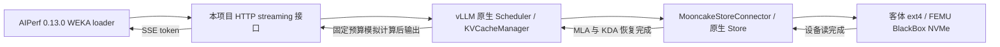

# AIPerf、原生混合缓存与 FEMU 联合验收

日期：2026-11-17。**联合功能闭环通过；包含 AIPerf 端到端 TTFT 的严格慢读对照未通过。** 两组均成功恢复混合缓存，设备读、GET、原生首 token 和入队后 HTTP 首 token 随慢读推迟；但请求入队前的人工冷缓存准备波动掩盖了客户端指标。不能将本轮标记为全部通过。

## 验收链路



AIPerf、HTTP 服务、Mooncake 均在同一个一次性 FEMU 客体内运行，通过客体 loopback 通信。存储目录实际位于 `/mnt/femu/server`，由 FEMU NVMe 承载。项目和解释器通过 9p 访问；日志写到项目输出目录，KV offload 写到 FEMU。关闭客体前将 offload 文件另存到 `disk-export/`。

保留真实的 vLLM 调度、缓存块管理、connector 对象组织与传输、Mooncake 存储、文件系统及 NVMe I/O。模型 forward 由固定预算等待替代；CPU KV 字节为可校验的占位内容；HTTP 层和执行循环仍由本项目实现。

## 实验配置与判据

- 输入 `examples/aiperf-two-requests.weka.json`：两条合成 WEKA 夹具请求，输入 256 / 320 tokens、各输出 4 tokens，共享前 256 tokens。它不是实际 Claude Code trace。
- AIPerf 0.13.0，causal 回放；可逆字符 tokenizer；实际 HTTP payload 重新分词核对 trace 长度、usage 和前缀摘要。
- `configs/hybrid-tiny.json`：1 个 MLA 层、1 个 KDA 层。第二条请求须恢复 4 个 MLA 对象（各 8192 B）及 1 个 KDA 快照（2624 B），合计 35392 B，全部 SHA256 通过。
- 固定 prefill 每 step 10 ms、decode 每 step 2 ms；第二条请求的总计算预算应为 16 ms。receiver 人为读等待为 0。
- 每次运行使用全新 FEMU。两请求之间等待磁盘副本建立，再仅清除 Mooncake 内存副本、本地 prefix cache 和客体页缓存。保留磁盘对象，不执行逻辑删除。
- FEMU TCG，2 vCPU、4 GiB RAM；512 MiB 原始 NAND、384 MiB 可见容量；两组仅把 NAND 页读从 40000 ns 调到 100000000 ns。

联合检查同时要求：请求无遗漏与重复、输入输出长度一致、混合恢复校验通过、块 trace 无丢失、GET 时间窗内有配对的 NVMe issue/complete，且完成顺序为 **GET → load_complete → compute_begin → 原生 first_token → HTTP 首 token**。AIPerf 请求 ID 与服务端请求 ID 必须能对应。对照还核对源码、依赖、tokenizer、输入、全部对象键/大小/摘要、FEMU 二进制和启动参数的一致性。

## 测量结果

两组分别为 `outputs/femu-aiperf-fast-01` 和 `outputs/femu-aiperf-slow-01`，guest 退出码均为 0，单组联合 `verification.json` 均为 `passed`。每组 2 条请求、576 个输入 tokens、8 个输出 tokens，第二条恢复 256 个前缀 tokens；混合对象校验全部通过。

下表比较同一条第二请求，而非两请求平均值：

| 指标 | 快读 40 μs | 慢读 100 ms | 慢读减快读 |
|---|---:|---:|---:|
| GET 内块读平均完成时延 | 0.117 ms | 100.092 ms | +99.975 ms |
| Mooncake GET | 146.307 ms | 559.978 ms | +413.671 ms |
| 原生 scheduler TTFT | 183.243 ms | 596.821 ms | +413.578 ms |
| 入队到 HTTP 首 token 发送 | 188.261 ms | 601.936 ms | +413.675 ms |
| **AIPerf 客户端 TTFT** | **1435.579 ms** | **1347.557 ms** | **−88.022 ms** |
| 摘要准备完成到原生入队 | 1126.980 ms | 628.874 ms | −498.106 ms |
| 占位摘要准备 | 100.167 ms | 72.563 ms | −27.604 ms |
| 模拟计算预算 | 16 ms | 16 ms | 0 |
| 实际计算窗口 | 22.837 ms | 24.872 ms | +2.035 ms |
| GET 内 NVMe 读次数 / 字节 | 5 / 49152 B | 5 / 49152 B | 相同 |

全部 10 个写出对象的键、大小和摘要一致；配置、源码、依赖、tokenizer、输入及 FEMU 启动参数匹配，只有允许的 trial 路径、临时 HTTP 端口与 NAND 页读参数变化。每组取回的 5 个对象逻辑字节为 35392 B，块层实际读取 49152 B；两者不等不代表数据错误，也不能据此推导 NAND 写放大。

慢读组在 GET 内的 5 次块请求均约 100 ms 完成。GET 增量不必等于 `5 × 100 ms`，因为块请求可重叠，且 GET 还有软件执行时间。

## 未通过项的定位

`outputs/femu-aiperf-comparison.json` 保留 `status: failed`，检查器退出码为 1；没有放宽“所有要求的时延均增加”的通过条件。其细分结果为：单组因果链通过、配对一致性通过、设备/GET/原生 TTFT 增加通过，包含客户端 TTFT 的全部时延增加未通过。

事件定位显示，第二条请求的 `http_received` 记录在占位摘要准备完成之后。到 `disk_replicas_confirmed` 的等待，快读为 1042.374 ms、慢读为 537.923 ms；完成内存驱逐和客体页缓存清理后才原生入队。该入队前阶段合计减少 498.106 ms，超过存储读及入队后首 token 增加的约 414 ms，因而端到端指标反向。

这说明当前显式冷缓存验收方式将磁盘副本等待和清缓存开销包含进客户端 TTFT。日志能确认干扰发生在哪个阶段；仅凭本配对不能进一步断言后台周期相位、TCG 或线程调度各贡献多少。

后续若要验收客户端端到端的慢读趋势，需把可观测、可等待的冷缓存准备阶段与被测请求发送分离，保持所有原始计时并重新运行配对及重复实验。正式自然淘汰实验则关闭人工冷缓存，另行验证容量压力。当前结果不能用挑选某次重跑替换，也不能把入队后指标改名为客户端 TTFT。

## 指标解释

原生 TTFT 从请求进入 scheduler 到其首 token。AIPerf TTFT 从客户端请求发送到收到首 token，额外包含 HTTP、占位摘要准备、请求入队等待以及本实验主动执行的冷缓存操作。不能把两者差额全算作 SSD 时间。

计算预算是模拟等待的目标值，实际计算窗口仍包含 CPU 复制和 TCG/操作系统开销，可能超过预算。只比较相同请求、相同对象与相同预算的配对结果；本轮单个配对不提供统计置信区间。

## 验证产物与复现

每组输出：`launch.json`、`joint/launch.json`、`joint/server/{run_manifest.json,events.jsonl,summary.json}`、AIPerf 原始请求/响应导出、`block-trace.txt`、`guest-block-stat.txt`、`disk-export/`。`joint/verification.json` 检查 HTTP 与设备计数；顶层 `verification.json` 进一步核对内核块事件到 HTTP 的顺序。

在项目根目录执行，每次使用新 trial 名：

```bash
.venv/bin/python scripts/run_femu.py --trial femu-joint-new-fast \
  --workload aiperf --nand-read-ns 40000 --timeout 2400
.venv/bin/python scripts/run_femu.py --trial femu-joint-new-slow \
  --workload aiperf --nand-read-ns 100000000 --timeout 2400
.venv/bin/python scripts/compare_femu.py \
  outputs/femu-joint-new-fast outputs/femu-joint-new-slow \
  --output outputs/femu-joint-new-comparison.json
```

`--workload replay` 保留此前直接提交请求的回归路径。`serve --femu-mount` 和 `run_aiperf.py --femu-mount` 用于 FEMU 客体；必须通过真实设备身份检查，不能以普通宿主目录替代。

比较命令无论通过或失败都会保存结果；严格比较未通过时返回非零退出码。现有这组数据会稳定重现上述失败判定。

回归记录：`outputs/joint-regression.log`，原有 **39 项通过**；`outputs/joint-verifier-tests.log`，新增 **6 项通过**，验证丢失 issue、trace 溢出、GET 窗口外完成、checksum 错误及 HTTP 提前输出会被拒绝。旧 FEMU 配对用新版检查器复核也通过（`outputs/femu-legacy-recheck.json`）。Ruff 和客体 shell 语法检查通过。

## 结论边界与下一步

此验收只覆盖两请求强制冷恢复。它不代表全量 WEKA、多 agent 并发下的自然淘汰压力或真实 GPU 服务性能。FEMU 未锁页、TCG、9p 和软件冷缓存操作均可带来额外开销。

本轮没有修复 Mooncake 删除后同键重新落盘的问题；本实验只清内存副本，保留旧磁盘对象。仍未覆盖真实模型 tokenizer、数值计算、跨 GPU/TP/RDMA、长期 GC/写放大，以及逐对象到文件偏移再到 LBA 的完整映射。

后续按 [WEKA 完整回放实施计划](../03-SSD负载与NAND实验/WEKA完整回放实施计划.md) 审计目标 trace、固定研究尺寸，并验证关闭强制冷缓存后自然容量压力是否产生 SSD 回读，再执行真实有界切片。
