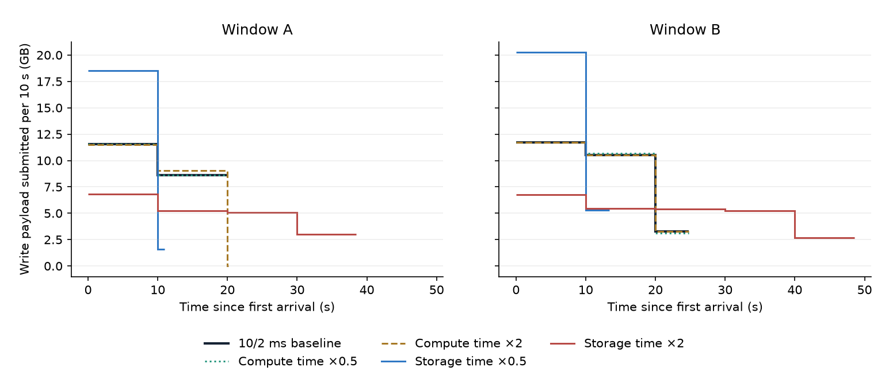

# kvlab 真实会话窗口的 SSD 对象负载验收

2026-11-24，在 n15 完成。**回放器已经能从带 UTC 时间的真实会话，推导单台 K3 在给定配置下向 SSD 提交了哪些对象、多少字节、何时提交。** 小容量独立留出试验三次都复现了全部 39 个写对象和 475,914,240 B。参考容量下，两个并发窗口的基准写入预测分别为 **20.126 GB 和 25.515 GB**，恢复读均为零。可信范围是这些窗口的对象负载。生产 K3 的长期读盘比例、写放大和 GC 频率仍缺少对应样本。[验收结果](../../evidence/kvlab-first-windows-20261124/acceptance.json) · [实测对账](../../evidence/kvlab-first-windows-20261124/native-holdout.csv) · [场景明细](../../evidence/kvlab-first-windows-20261124/sensitivity.csv)

| 实施项 | 结果 | 能检验什么 |
|---|---|---|
| 固定输入，扫描全库 | 通过。原始文件、3,190 个会话索引及 370,658 个请求已核对 | 上下文覆盖、依赖闭合、源端实际重叠 |
| 冷启动选窗，编译输入 | 通过。n15 两个窗口各 1 个请求，参考配置两个窗口各 2 个会话、3 个请求 | 完整保留窗口内的竞争流量，重建等待与返回 |
| n15 原生配对 | 写对象、请求、rank、尺寸、提交字节三次全部匹配。自然磁盘读正例为零 | 验证短窗口的写入预测，量化时间误差 |
| 正读采集自检 | 受控清缓存后，文件读入口和成功 GET 按键对上 4 次、131,072 B | 验证观测器可以看到真正进入文件后端的读 |
| `0504` FEMU 回归 | 规定的对象账本与零 GET 通过。最终内存副本的完整比较有差异 | 保留原有设备对照及其误差 |
| 参考容量敏感性 | 完成 20 次。两对窗口分别跑 5 组，其中长窗口共 10 次 | 区分写入总量、10 秒内到达的字节数，以及后台排空时间 |

## 1. 全库有多少请求可以原样回放

输入为 WEKA 发布的 replay-v5，文件长 8,816,390,440 B，SHA-256 为 `337a03810637e0d062c2f320bd6a17392a476fa19e196a80e3a7359a47731f61`。从公开 Quay 镜像取回文件后，对照固定 Hugging Face revision，逐会话核对索引偏移、长度、请求数和 UTC 起止。全库有 17,349 个非空实例，记录输入共 91,591,785,836 token。[原始数据固定版本](https://huggingface.co/datasets/wekaio/replay-40d-oct14-337a03810637/tree/5afaa89882fc2c24a3dcb8bcdcd0485770c5021d) · [版本和校验值](../../evidence/kvlab-first-windows-20261124/provenance.json) · [全库审计](../../evidence/kvlab-first-windows-20261124/audit.json)

用记录的 `input_tokens + output_tokens` 检查上下文。源端的预填充、cache read 和 cache creation 是输入用量的组成部分，重复相加会高估请求长度。44,907 条记录缺少正的输入或输出用量，保留在分母和录制并发曲线中。表中“依赖闭合”要求请求本身和全部因果前序都可执行，“完整会话”要求该会话的每个请求都满足此条件。

| 上限 | 直接可执行请求 | 依赖闭合请求及占全库比例 | 闭合请求的输入 token 及占全库比例 | 完整会话 |
|---|---:|---:|---:|---:|
| n15，12,288 | 2,519 | 1,962（0.5293%） | 3,286,172（0.00359%） | 6 |
| 参考配置，131,072 | 66,478 | 30,760（8.2988%） | 2,589,159,147（2.82685%） | 680 |

两档分别有 557 和 35,718 个请求自身合规、但前序无法完整执行。把这些轮次单独送进空缓存会改变回读概率。每日的请求量、闭合比例和 token 覆盖均已保留。[按 UTC 日统计](../../evidence/kvlab-first-windows-20261124/daily-coverage.csv)

## 2. 如何保留并发与缓存历史

源时钟使用半开区间 `[ts, ts + total_ms)`。全库同时在途的 API 请求峰值为 **26**。对 `prev` 和 `spawn` 前序逐条还原有符号时间差，有 33,972 条前序尚在执行，其中 33,967 条按整毫秒计为负，与发布方的 `think_clamped` 完全一致。其余 5 条重叠不足 1 ms。对于原本重叠的请求，目标回放按“前序开始 + 观测偏移”放行。其余从属请求按“目标前序完成 + 原等待间隔”放行。独立根保留彼此的 UTC 偏移。用源端耗时替换目标耗时做校验，所选窗口每一条记录都恢复到原 UTC 纳秒。目标设备速度改变后，实际并发仍可变化。[源端并发全曲线](../../evidence/kvlab-first-windows-20261124/recorded-concurrency.csv.gz) · [各窗口两种时钟的在途数](../../evidence/kvlab-first-windows-20261124/inflight.csv)

选窗先看源记录。每个窗口从 API 无在途且有新会话开始的边界起步，把这段时间内的所有到达送往一台 K3。凡涉及更早开始的会话、超限前序、依赖缺失或遗漏在途调用，该候选即排除。优先选“中间插入另一会话后返回同一有指纹前缀”的窗口。默认预算为 300 s 和 24 个请求。n15 另行放宽到全录制期和全库请求数，符合冷启动、依赖完整且可识别至少一个 1,536-token 前缀的候选仍只有 5 个，全部只有一次请求。校准和留出在每对内使用不同会话。每个窗口从空缓存开始，前两次请求构成参考窗口的预热。生产服务在空闲时可能仍持有更早会话的缓存。[n15 选窗记录](../../evidence/kvlab-first-windows-20261124/paired-selection.json) · [参考选窗记录](../../evidence/kvlab-first-windows-20261124/reference-selection.json)

| 窗口 | 源端起点（UTC） | 输入 / 实际输出 token，按到达顺序 | 源窗口长度 |
|---|---|---|---:|
| n15 校准 | 09-24 00:23:20 | 2,006 / 19 | 1.512 s |
| n15 留出 | 09-25 17:53:08 | 1,988 / 14 | 1.694 s |
| 参考 A | 09-05 16:20:35 | 87,280 / 633、22,497 / 16、88,250 / 150 | 14.934 s |
| 参考 B | 09-06 04:37:20 | 59,880 / 108、23,045 / 19、76,909 / 704 | 12.485 s |

## 3. 输入指纹怎样影响 SSD 预测

trace 提供脱敏的块哈希和长度估计。编译器按 kvlab 的规则排列 system、tools、messages，跳过首个小于 200 B 的系统计费块。对相同的角色和内容哈希，用该窗口第一次出现时的长度生成稳定的合成 token。每条请求维持原始总长度，缺少指纹的尾部按请求隔离。估计超出总长的部分记录在清单。原生 vLLM 在这些 token 上计算 K3 的块键。真实提示词和 K3 tokenizer 产生的原始 token ID 在发布数据中不可见。[上游前缀规则](https://github.com/weka/kvlab/blob/3fd1a8411f9f30b6c54fda850a094b809c331d51/benchmark/replay_router.go#L1377) · [编译器](../../src/kv_ssd_sim/workload/compiler.py)

A 窗口中，同一 system 内容哈希两次被估为 4,221 和 4,203 token。初版按请求独立展开，返回请求仅保留 4,254 个共同 token，预测写入 31.435 GB。固定重复哈希长度后，共同前缀增至 **74,728 token**，vLLM 本地实际复用 **73,728 token**，预测写入降至 **20.126 GB**。B 窗口共同前缀为 4,227 token，本地复用 3,072 token。源端报告的 Claude cache read 在两条返回请求上分别为 87,278 和 0 token。这一字段可核查重建误差，直接把它当 K3 命中或 SSD 读会混淆模型、路由与驻留层级。[A 的输入账本](../../evidence/kvlab-first-windows-20261124/reference-calibration.json) · [B 的输入账本](../../evidence/kvlab-first-windows-20261124/reference-holdout.json) · [修正前的输入和预测](../../evidence/kvlab-first-windows-20261124/prefix-diagnostic.tar.gz)

## 4. 用 n15 校准，再盲验写入与回读

小容量两端使用 22 块/rank、8 个逻辑 rank、1 个 Mooncake 客户端、2,520 MiB Store、96 MiB staging 和 2,840 MiB 文件配额。在线端运行真实 CPU 缓冲、vLLM 调度器与同版本 Mooncake，使用宿主文件系统。对象端运行调度器、connector 和同版本 master 的原生分配及淘汰逻辑，通过虚拟时钟推进副本状态，KV 有效载荷只保留尺寸和键。两端都跳过 GPU forward。

在线观测器记录每个键的 PUT 分配回执、内存就绪、提交文件写、开始写 bucket、文件写完和磁盘副本确认。文件读从实际读入口及完成结果计数。附加副本查询使用 master 的只读管理接口，保留原请求的租约语义。校准和对账以首个请求接纳为零点。每个提交在所属的 10 秒区间计一次，后台工作跟踪到排空。事件表同时保留实际文件写完与 master 回执的时刻。[原生观测器](../../native/object_replay_observer.cpp) · [计时拟合和逐键比较](../../scripts/analyze_kvlab_native.py) · [原生事件归档](../../evidence/kvlab-first-windows-20261124/native-events.tar.gz)

仅使用 9 月 24 日的校准请求拟合。1 个 prefill step 实际耗时 508.05 ms，其中 CPU 物化占 507.89 ms。18 个 decode step 的实际耗时中位数为 2.49 ms。按 8 个有写入的 rank 作业，计算栅栏就绪后到首次分配、最后内存就绪的中位数为 199.52、464.12 ms。两个 bucket 给出的文件开始到确认的等效服务率为 145.28 MiB/s。估算首次后台轮询相位为 298.89 ms，包含源数据获取开销。以上数值用于 n15 同类请求的时间拟合。在线端三次验证都保留 10/2 ms 计时预算，参考机的敏感性组也独立使用其设定值。[冻结参数和样本量](../../evidence/kvlab-first-windows-20261124/calibration.json)

留出请求的预测只计算一次，各轮开始前校验相同的输入与预测哈希。下表时间差为“预测减实测”的逐键中位数。每轮的写对象均按请求、rank、键、字节和次数对账。每轮磁盘读的命中正例、误报、漏报均为 0。召回率分母为 0。受控清缓存集成测试另外捕获 4 次成功文件读，说明观测路径可工作。[三次留出逐项结果](../../evidence/kvlab-first-windows-20261124/native-holdout.csv) · [逐键时间与未匹配键](../../evidence/kvlab-first-windows-20261124/validation/) · [受控读自检](../../evidence/kvlab-first-windows-20261124/controlled-read.json)

| 留出轮次 | 实测写对象 / 字节 | 实测磁盘读 | 首次分配误差 | 内存就绪误差 | 文件提交误差 | 磁盘确认误差 |
|---|---:|---:|---:|---:|---:|---:|
| 1 | 39 / 475,914,240 B | 0 B | −61.67 ms | +36.76 ms | −0.93 ms | −0.42 ms |
| 2 | 39 / 475,914,240 B | 0 B | −21.23 ms | +33.75 ms | −63.52 ms | −155.68 ms |
| 3 | 39 / 475,914,240 B | 0 B | −35.02 ms | +24.35 ms | −89.53 ms | −174.78 ms |

三轮请求从接纳到完成分别为 554.31、556.93、559.54 ms，预测为 540.42 ms。每轮所有写入均落在同一个 10 秒箱内。精确字节对账仍允许箱内有明显时间偏差。这组真实窗口没有产生自然内存淘汰或磁盘 GET，无法估计有回读时的预测准确率。

## 5. 参考容量下到达 SSD 的负载

设定每 rank 1,876 块、8 个独立逻辑客户端，每客户端 Store 128 GB、staging 4 GiB、文件配额 375 GB，8 个客户端共用一条虚拟盘队列。每个窗口基准使用 10/2 ms 计算时间、1 ms 保存服务时间、单盘 1,024 MiB/s 和每客户端 8,192 MiB/s 内存读。另四组分别把计算时间或存储服务时间乘 0.5 和 2。改变存储时间时按反比调整盘和内存服务率，后台轮询间隔与租约保持相同。回放器输出对象到达的字节量，10 秒峰值按提交时间分箱，最后一个箱保留实际截止边界。[全部 20 次场景结果](../../evidence/kvlab-first-windows-20261124/sensitivity.csv) · [逐对象、bucket、rank 和原始事件](../../evidence/kvlab-first-windows-20261124/predictions.tar.gz)

| 基准值或五组范围 | 参考 A | 参考 B |
|---|---:|---:|
| 基准唯一对象 | 1,946 | 2,462 |
| 基准提交写入 | 20,126,490,624 B | 25,515,491,328 B |
| 其中最后一个请求结束后提交 | 16,713,695,232 B | 21,585,795,072 B |
| 基准最大 10 秒写入 | 11,534,936,064 B | 11,718,183,936 B |
| 五组写入总量范围 | 20.126–20.576 GB | 25.515 GB |
| 五组最大 10 秒写入范围 | 6.810–18.520 GB | 6.783–20.250 GB |
| 从首个请求到最终统计边界，五组范围 | 10.99–38.49 s | 13.38–48.53 s |
| 五组对象读及读字节占比 | 均为 0 B，0% | 均为 0 B，0% |

返回请求进入前，A 的本地池有 184 个可查的缓存哈希，Store 内存有效载荷 17,692,065,792 B，已确认磁盘副本 781,544,448 B。B 分别为 142 个、13,727,268,864 B、0 B。两侧都可能已在后台排队写入。B 的源端峰值并发为 2，基准回放也是 2，计算时间减半时变为 1。已保留预热阶段及计量阶段两套字节曲线，可分别回答“整次实验写了多少”和“旧前缀返回时盘上是什么状态”。[窗口时钟](../../evidence/kvlab-first-windows-20261124/inflight.csv) · [预热边界与后台尾部](../../evidence/kvlab-first-windows-20261124/sensitivity.csv)



## 6. 与 FEMU、真实部署的边界

用历史 KVM `0504` 两轮作独立回归。208 个唯一对象、2,402,574,336 B、逐请求和逐 rank 的 PUT、零 GET、最终磁盘键均对上。实测内容摘要为 `173bfdbe0ff676b4301cee05be60c30795a68772776cbd8565773d966fda0999`。最终内存键为预测 195、实测 197，其中仅预测保留 4 个、仅实测保留 6 个。完整对账文件保留了失败标志。历史 FEMU 在 `first_send → device_end` 记录 2,403,450,880 B 主机写、8,192 B 主机读、等量于主机写的 NAND 编程、零 GC 搬迁和零擦除。对象 GET 与整盘块读各有独立计数。[本轮与历史实测的逐键比较](../../evidence/kvlab-first-windows-20261124/regression.json) · [原 KVM 归档](../../evidence/n15-kvm-20261120-074735/)

当前可采信的量是给定窗口、容量、路由、冷启动和服务时间后，送入文件后端的对象负载，以及 n15 已校验部分的误差。真实路由与跨窗口驻留、Claude 到 K3 的前缀还原、B300 的每步耗时、存储队列并行度均会影响外推。要研究长期物理 SSD，首要补充是具有已知前史、会发生自然文件回读的独立实测窗口，随后可携带相同预热状态和后台尾部，把持续替换段交给 FEMU 或设备测量 LBA、NAND 和 GC。40 天的覆盖审计和窗口预测分别保留其分母。[三层系统差距与架构图](对象回放器-FEMU-真实服务器差距说明.md)

## 7. 复现与原始证据

n15 的实跑目录为 `.object-replay-build/trials/kvlab-20261124/`。其中 `corpus/index.sqlite` 可按会话、请求和时间查询。`online-cal/` 与 `online-holdout-{1,2,3}/` 包含真实 bucket 文件。`demand-reference/{calibration,holdout}/{场景}/` 的 `ssd-demand.jsonl.gz` 每行有提交、开始、完成、键、长度、rank、owner、bucket。`ssd-10s.csv` 保留零流量区间。`evidence/` 归档中包含精简原生日志、冻结输入、完整对象预测、校验和及工作区文件哈希。Git 基点为 `775c8ce6d2ec810dcc5f0ec60cab8b07b62ee4eb`。运行清单记录当时的依赖哈希，归档清单另记事后工作区状态。[证据目录](../../evidence/kvlab-first-windows-20261124/) · [文件校验和](../../evidence/kvlab-first-windows-20261124/SHA256SUMS)

在已安装项目固定 wheel、GCC 12 和 n15 Python 环境的宿主上，可从项目根目录执行下列命令。复现脚本创建新目录，按顺序完成数据校验、编译、有效样本选择、校准、三次留出、参考敏感性和归档。原生 HTTP/master 使用本机回环端口。Matplotlib 使用 n15 的 SAN 环境，也可通过 `K3_PLOT_PYTHON` 指向其他安装了 Matplotlib 的解释器。

```bash
cd /home/yzh/projects/kv-ssd-sim
(cd evidence/kvlab-first-windows-20261124 && sha256sum -c SHA256SUMS)
bash scripts/reproduce_kvlab_n15.sh .object-replay-build/trials/kvlab-repeat-01
```

单步入口和运行顺序均在脚本中。原始数据可在 n15 缓存复用。新宿主可从固定的 Quay 层或 Hugging Face revision 取回并校验。115 个测试通过，其中 6 个使用原生服务。已有证据的独立回归保留了上述最终内存键差异。[复现脚本](../../scripts/reproduce_kvlab_n15.sh) · [来源获取](../../scripts/fetch_kvlab.py) · [审计与选窗](../../scripts/prepare_kvlab.py) · [原生观测器构建](../../scripts/build_object_observer.py) · [五组场景](../../scripts/run_kvlab_matrix.py)
