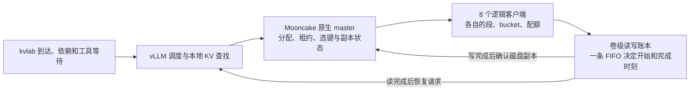

# 八盘逻辑卷对象回放与验收

本文保留第一版逻辑卷实验。当前工作树用 `reference-volume-20261125` 复现本页的 4× 默认速率和旧 GET 计时。`reference` 已切换到单设备、默认 1×、带有界暂存和目标 rank 传输的主配置。[当前大容量单盘与恢复验收](大容量单盘与两阶段KV恢复验收.md)

2026-11-25，n15。**八卡 Kimi K3 TP8 的主实验已使用一个 24 TB KV 逻辑卷。** 在 7 个 kvlab 会话的 136 个连续请求上，三档卷速率及 3 TB 单盘对照均向卷提交 19,992 个唯一对象、235,572,461,568 B 写入，读取 0 B。各组的写入突发和响应后的后台写入不同。另在有容量压力的返回用例中，仅改变卷速率就改变了哪些键需要回读。[四组主实验](../../evidence/tp8-logical-volume-20261125/comparison.json) · [压力用例逐键结果](../../evidence/tp8-logical-volume-20261125/probe-comparison.json)

## 1．实验配置与观测位置

NVIDIA 给出的 DGX B300 缓存盘为 8 × 3.84 TB E1.S NVMe，系统启动盘单列。DGX OS 文档建议缓存用途使用 RAID 0。本项目据此选用**一个整机逻辑卷**作为对象 I/O 的观测位置，给出了每客户端 3 TB 和共用一条服务队列这两个实验假设。真实部署的 RAID 方式、条带大小和服务率仍需在目标机上确认。[DGX B300 硬件规格](https://docs.nvidia.com/dgx/dgxb300-user-guide/introduction-to-dgxb300.html) · [DGX OS 数据盘配置](https://docs.nvidia.com/dgx/dgx-os-7-user-guide/installing_on_ubuntu.html)

| 设置 | 八盘逻辑卷主实验 | 单盘受控实验 |
|---|---|---|
| 在当前工作树上的复现入口 | `--profile reference-volume-20261125` | `--profile reference-single-ssd` |
| KV 对象与调度 | K3 TP8，约 55 GiB 本地 KV/卡（共约 440 GiB），2,781 块/rank，最多 8 条序列、4,096 token/step | 相同 |
| 单请求输入加输出上限 | 1,048,576 token | 默认 131,072，和主实验配对时显式设为 1,048,576 |
| Mooncake 客户端 | 8 个逻辑客户端，各有 128 GB Store、4 GiB staging，合计 1.024 TB Store | 相同 |
| 标称 SSD 容量与 KV 文件配额 | 8 × 3.84 TB，合计 30.72 TB。8 个独立的 3 TB 配额，合计 24 TB | 1 × 3.84 TB。8 个独立的 375 GB 配额，合计 3 TB |
| 磁盘回收水位 | 各客户端按自身配额的 90%/80% 检查，即 2.7/2.4 TB | 每客户端 337.5/300 GB |
| 卷服务 | 双向共用一条先进先出队列。`--volume-service` 可取 `1x`、`4x`、`8x` | 相同队列，固定单盘参考速率 |

容量与带宽中的 GB、TB 均为十进制，GiB 为二进制。客户端只能花自己的配额。账本分别记录请求 rank、持有对象的客户端 `owner`、bucket 和对象类型。MLA 可跨 rank 共享，KDA 保留 TP 分片。`owner` 可以回答哪个客户端写出这些对象。要定位到物理成员盘，还需文件偏移和卷到成员盘的映射。[八盘配置与参数来源](../../configs/kimi-k3-b300-logical-volume.json) · [固定的单盘配置](../../configs/kimi-k3-b300-object-replay.json)



单成员顺序规格取 Micron 7450 PRO 对应 E1.S 型号的读 6.8、写 5.0 GB/s。三档卷级读/写分别为 **6.8/5、27.2/20、54.4/40 GB/s**。默认 **4×** 是待校准的中间情景，**8×** 是按单成员顺序规格相加的情景。每个 bucket 的服务时间按其实际字节数和方向计算，读写互相排队，提交时刻与完成时刻分别记录。GPU forward 和 KV 字节继续虚拟化，计算和主存复制沿用前版公开参考时钟。省略 `run_object_replay.py` 的 `--profile` 仍进入 n15 小容量配置。[Micron 单成员速率](https://www.micron.com/products/storage/ssd/data-center-ssd/7450-ssd/part-catalog) · [计算时钟与来源](单机八卡公开参考配置与上下文覆盖.md) · [运行入口](../../scripts/run_object_replay.py)

## 2．选窗和预热

1. 对已审计的 WEKA kvlab 40 天录制按源 UTC 时间选窗。要求从没有在途 API 的新会话起点开始，能完整执行窗内贡献会话的前序，保留中间所有到达，并出现其他会话插入后再次使用同一实例前缀。在合格候选中取请求数最多的一窗，请求数相同取最早起点。选窗只读取源记录。[选窗实现](../../src/kv_ssd_sim/workload/windows.py) · [冻结的选择结果](../../evidence/tp8-logical-volume-20261125/selection.json)
2. 入选时段为 **2026-09-06 04:37:20.551599263 至 05:00:27.075075142 UTC**。7 个会话、136 个请求合计 17,000,396 输入 token、87,469 输出 token，最长单次输入 202,304。源 API 与回放中已接纳而尚未完成的请求峰值均为 3。原录制来自 Claude，会话中的可识别共享前缀由脱敏指纹重建，回放时按 K3 布局生成对象。将窗内全部会话路由到一个 TP8 实例，起点设冷。源端空闲之前其他会话可能留下的驻留对象属于未知前史。这段包含此前三请求窗口 B，长窗结果与 B 有共同的输入。[逐请求时间、前缀和依赖](../../evidence/tp8-logical-volume-20261125/warm-window.json)
3. 预先选定**源顺序第 33 个请求** `01cbca8f-1cdd-4727-9d21-3b5205b51306/1960811` 的接纳时刻作为测量起点。全部四组在同一进程内连续执行，跨界保留本地 KV、Store 副本、租约和后台工作。测量起点的虚拟时刻均为 **320.756269648 s**。依赖后继按目标完成时刻推进，接纳次序随之调整，此时实际已有 **35 个请求被接纳、34 个已完成**。原始输入独立编译两次，生成的输入与窗口清单逐字节一致。[输入、版本与编译复核](../../evidence/tp8-logical-volume-20261125/provenance.json)

测量起点的 Store 驻留均为 **76,622,340,096 B**，本地缓存有 **819** 个哈希，当时本地池占用约 **3.13%**。1× 和单盘组已发布 76,622,340,096 B，4× 和 8× 已发布 74,769,997,824 B。已有对象何时赶上客户端轮询，会改变写入落在预热还是测量段。正式对照使用同一输入摘要 `1c66fc3940376e972c3ef34cfafd6ae13b1c8792d34b7593ef59dae002d7d997`。[四组的起点快照](../../evidence/tp8-logical-volume-20261125/comparison.json)

## 3．主实验的对象写入、突发与尾部

下表按**提交时刻**计数。全窗从冷启动到后台排空，测量段从约 320.756 s 到排空。10 s 峰值取从各自起点对齐的固定 10 s 区间中提交字节最多的一格。最后一列是最后一笔卷 I/O 完成时刻减去最后一个请求完成时刻。每档主实验各执行一次。[按客户端、类型及窗口的原始数值](../../evidence/tp8-logical-volume-20261125/comparison.json)

| 配额 / 服务率 | 全窗读 / 写（GB） | 测量段写（GB） | 全窗 / 测量段 10 s 峰值（GB） | 最后响应后才提交的写（GB） | 至最后 I/O 完成（s） |
|---|---:|---:|---:|---:|---:|
| 单盘 3 TB，1× | 0 / 235.572 | 158.950 | 25.515 / 24.067 | 1.573 | 6.034 |
| 整卷 24 TB，1× | 0 / 235.572 | 158.950 | 25.515 / 24.067 | 1.573 | 6.034 |
| 整卷 24 TB，4× | 0 / 235.572 | 160.802 | 30.097 / 30.097 | 0.597 | 7.305 |
| 整卷 24 TB，8× | 0 / 235.572 | 160.802 | 31.678 / 31.678 | 1.396 | 5.203 |

- **工作集与回读。** 全窗 15,898,112 个输入 token 在本地命中，另有 1,102,284 个需要计算。Store GET 为 0，内存和磁盘对象淘汰均为 0。结束时 Store 约占 1.024 TB 的 **23.0%**，整卷已发布数据只占 24 TB 配额的 **0.98%**。最大的客户端盘上峰值为 29,457,174,528 B，离自身 2.7 TB 的高水位很远。该窗口覆盖已有缓存的运行阶段，尚未达到持续替换所需的容量压力。
- **写入构成。** 全窗 MLA 有 8,184 个唯一对象、14,481,358,848 B，KDA 有 11,808 个、221,091,102,720 B，分别占写字节约 6.15% 和 93.85%。四组逐项比较写入键、所属客户端、大小和出现次数，完全相同，摘要记录在 `write_identity_sha256`。按实际 `owner` 计数，各客户端全窗写入 29,437,710,336 至 29,457,174,528 B。各客户端及各类型之和都与卷总字节一致。
- **提交与排队。** 单盘和 1× 各有 1,208 笔 bucket 写，4× 有 1,202 笔，8× 有 1,233 笔。各组“已提交、未完成”的字节峰值均为 2,110,811,136 B。最后响应发生在 1,387.194381623 s，当时在途为 0，随后仍有尚待客户端提交的写。每个客户端本轮工作完成后再等 10 s 才进行下一轮，改变盘服务率会移动下次分桶和提交时刻，后台尾部因而可以随速率非单调变化。[卷级提交与完成账本](../../evidence/tp8-logical-volume-20261125/warm-runs.tar.xz) · [客户端轮询实现](../../src/kv_ssd_sim/simulation/storage/offload.py)

## 4．有自然回读时，服务率会不会改变选键

沿用 35 s 后返回旧前缀的同一输入，把配置缩到 1 个客户端、11 块/rank、1,450 MiB Store、96 MiB staging、2,840 MiB 文件配额、12,288 token 上限。租约和后台轮询间隔均为 10 s，轮间保留缓存。仅改变卷服务率。三个场景全部产生 120 次 rank 级 GET、写入 1,411,817,472 B。[逐键差异与归档输入](../../evidence/tp8-logical-volume-20261125/probe-comparison.json) · [对照组原始事件](../../evidence/tp8-logical-volume-20261125/controls.tar.gz)

| 服务率 | 首个 bucket 发布（s） | 内存 GET | 虚拟盘 GET / 唯一读键 | 卷读字节 | 与 4× 相比 |
|---|---:|---:|---:|---:|---|
| 1× | 10.050451 | 96 | 24 / 3 | 42,467,328 | 逐次相同 |
| 4× | 10.012613 | 96 | 24 / 3 | 42,467,328 | 参照组 |
| 8× | 10.006306 | 112 | 8 / 1 | 14,155,776 | 少读 2 个 MLA 键，各少 8 次 |

三组在 20 s 各回收 9 个内存键，8× 与 4× 选中的 9 个键中有 4 个不同。4× 回收的两个 MLA 键在 8× 保留了内存副本，旧前缀返回时有 16 次 GET 改走内存，少读 **28,311,552 B**。逐次复核了原生副本状态、卷读提交、完成与恢复。8× 在新进程再跑一次，请求、事件和 SSD 汇总逐字节一致。这里验证的是回放器中卷服务时刻对选键和恢复的反馈。要评价真实部署的自然回读预测精度，仍需在同条件、独立会话中与原生文件读逐键对账。[差异键、时刻与复跑摘要](../../evidence/tp8-logical-volume-20261125/probe-comparison.json) · [原生文件读验收口径](八卡对象回放评审核对与验收标准.md)

## 5．实施与复现

| 验收项 | 结果与代码 |
|---|---|
| 八盘配置可选、单盘历史可复现 | 通过。主配置逐次记录有效容量、队列数、服务率和配置哈希。历史 128K 三请求窗口的 `events.jsonl`、`requests.json`、`ssd-summary.json` 与旧归档逐字节相同，运行汇总仅原生进程峰值 RSS 不同。[启动器](../../scripts/run_object_replay.py) · [旧基线复核](../../evidence/tp8-logical-volume-20261125/single-drive-regression.json) |
| 连续历史与配对运行 | 通过。选窗、独立重编译、同一输入四组回放、实际边界状态均已核对。矩阵入口另有三请求冒烟验证。[编译与选窗](../../scripts/prepare_kvlab.py) · [场景矩阵](../../scripts/run_kvlab_matrix.py) · [运行来源记录](../../evidence/tp8-logical-volume-20261125/provenance.json) |
| 卷级对象账本 | 通过。按实际 owner、类型、时间窗及 GET 身份对账，核对每笔服务时间、读写队列顺序与前台结束后的余量。归档含四组的请求、原始事件、bucket 时序、逐对象提交/完成以及 10 s 曲线。[负载导出](../../src/kv_ssd_sim/analysis/traffic.py) · [检查器](../../scripts/compare_volume_replay.py) |
| 测试 | 113 项非集成测试、6 项原生集成测试通过。新增用例覆盖预热锚点、所有者与 rank 不同的对象归属以及按客户端触发盘配额回收。[测试记录](../../evidence/tp8-logical-volume-20261125/tests.log) · [原生集成记录](../../evidence/tp8-logical-volume-20261125/native-integration.log) |

在 n15 项目根目录可直接解包重算，对比两个输出与归档值。只读检查器使用 Python 3.11 或更高版本及标准库。

```bash
cd /home/yzh/projects/kv-ssd-sim
ev=$PWD/evidence/tp8-logical-volume-20261125
work=$(mktemp -d .object-replay-build/trials/volume-check-XXXXXX)
(cd "$ev" && sha256sum --quiet -c SHA256SUMS)
tar -xJf "$ev/warm-runs.tar.xz" -C "$work"
tar -xzf "$ev/controls.tar.gz" -C "$work"
python3 scripts/compare_volume_replay.py "$work/warm" --window "$ev/warm-window.json" > "$work/main.json"
python3 scripts/compare_volume_replay.py "$work" --pressure > "$work/pressure.json"
cmp "$ev/comparison.json" "$work/main.json"
cmp "$ev/probe-comparison.json" "$work/pressure.json"
```

从 40 天录制重新选窗并跑完整矩阵时，沿用 n15 的固定运行环境。若已有已审计的 `corpus/index.sqlite`，可用其目录替代下面的 `audit` 步骤。也可在新的 `input/warm/` 目录中解压归档的 [warm-input.json.xz](../../evidence/tp8-logical-volume-20261125/warm-input.json.xz) 为 `input.json`，复制上述 `warm-window.json` 为 `window.json` 后直接运行矩阵。

```bash
cd /home/yzh/projects/kv-ssd-sim
source .object-replay-build/trials/kvlab-20261124/env.sh
work=$(mktemp -d .object-replay-build/trials/volume-repro-XXXXXX)
src=.object-replay-build/kvlab-source/replay-40d-oct14-337a03810637.jsonl
"$py" scripts/prepare_kvlab.py audit "$src" --output "$work/corpus"
"$py" scripts/prepare_kvlab.py warm-window "$src" --audit "$work/corpus" \
  --output "$work/input" --warmup-requests 32
export PYTHONHASHSEED=0
"$py" scripts/run_kvlab_matrix.py "$work/input" --window warm --profile reference-volume-20261125 --output "$work/runs"
"$py" scripts/compare_volume_replay.py "$work/runs/warm" \
  --window "$work/input/warm/window.json" > "$work/comparison.json"
```

压力用例沿用其历史哈希设置。下列命令重建三档及 8× 重复运行。原始 n15 试验目录为 `.object-replay-build/trials/logical-volume-20261125-2bqxD5/`。各组的 `launch.json` 保留运行时输入、代码和原生二进制哈希，归档另记工作树的基础提交及检查器哈希。[归档来源](../../evidence/tp8-logical-volume-20261125/provenance.json) · [完整性清单](../../evidence/tp8-logical-volume-20261125/SHA256SUMS)

```bash
source .object-replay-build/trials/kvlab-20261124/env.sh
work=$(mktemp -d .object-replay-build/trials/volume-pressure-XXXXXX)
tar -xzf evidence/tp8-logical-volume-20261125/controls.tar.gz -C "$work" inputs/return-idle.json
unset PYTHONHASHSEED
for run in 1x 4x 8x 8x-repeat; do
  "$py" scripts/run_object_replay.py "$work/inputs/return-idle.json" \
    --profile reference-volume-20261125 --volume-service "${run%%-*}" --clients 1 --num-blocks 11 \
    --max-model-len 12288 --segment-mib 1450 --staging-mib 96 --quota-mib 2840 \
    --output "$work/probe-$run"
done
"$py" scripts/compare_volume_replay.py "$work" --pressure > "$work/pressure.json"
```

当前证据支持回答这段输入在给定路由、缓存历史和速率下向**整个卷**提交的对象负载。估计持续压力下的整机读写比，还需要涵盖自然淘汰和旧前缀返回的更多独立时间段。要研究一块成员盘上的负载和 GC，下一层需要对应部署的条带或目录映射、盘上已有数据及同一时间窗的块 I/O 和 NAND 计数。[对象层与设备层的验收边界](对象回放器-FEMU-真实服务器差距说明.md)
