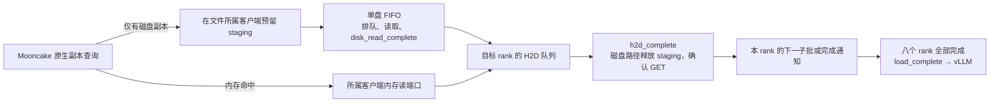

# 大容量单盘与两阶段 KV 恢复验收

2026-11-25，n15。**当前八卡参考回放模拟一块大容量 SSD。一次磁盘 GET 有两个完成时刻，分别是 SSD 已交付字节，以及 KV 已到达目标 rank。vLLM 在所有 rank 恢复完成后收到通知。** 在 35 秒自然返回用例中，最后一笔 SSD 读完成与整次恢复完成相隔 **4.205136 ms**。在相同输入和 SSD 服务率下，新模型使请求相对旧模型晚完成 **0.095304 ms**。旧模型中也有一部分内存 GET 在最后一笔盘读之后完成，因此这两个时间差的含义不同。[新旧路径逐键与时刻对账](../../evidence/large-ssd-staged-20261125/base-paired.json)

## 1．一台服务器、一块逻辑 SSD

| 正式设置 | 取值及含义 |
|---|---|
| 参考入口 | `--profile reference`。Kimi K3 TP8，1,048,576 token 上限，2,781 个本地 KV 块/rank |
| 主存与文件配额 | 8 个逻辑 Store 客户端各贡献 128 GB 主存，合计 1.024 TB。单盘标称容量 30.72 TB，文件配额 24 TB，各客户端独立使用 3 TB，按自身 90% / 80% 水位回收 |
| SSD 服务 | **一个设备、一条读写共用的 FIFO**。默认读 6.8 GB/s、写 5.0 GB/s，即 `1x`。`4x` 和 `8x` 仅改变这条队列的服务率。`launch.json` 记录设备数、队列数和生效速率 |
| 恢复资源 | 每个文件所属客户端有 4 GiB 恢复暂存空间。每个目标 rank 有一个主机到设备（H2D）传输端口，默认 55.7 GB/s。内存 GET 与盘读后的传输竞争同一个目标端口 |
| 对照 | 3 TB 小盘为 `reference-single-ssd`。单独运行该历史配置默认沿用旧恢复时钟，当前矩阵显式给小盘也启用 `--restore-path host-staged`。上一轮默认 4× 的八盘容量抽象可用 `reference-volume-20261125` 重现 |

30.72 TB 取自 DGX B300 八块 3.84 TB 缓存盘的容量之和。24 TB 是项目分配给 KV 的预算。速率采用单颗 Micron 7450 PRO E1.S 的顺序参考值，55.7 GB/s 沿用公开的大块主机到 GPU 复制测量。它们均为虚拟时钟输入。省略回放器的 `--profile` 仍运行 n15 小容量配置，该入口也默认启用分阶段恢复，使用该配置自己的内存带宽。[机器可读配置与来源](../../configs/kimi-k3-b300-large-ssd.json) · [DGX B300 缓存盘规格](https://docs.nvidia.com/dgx/dgxb300-user-guide/introduction-to-dgxb300.html) · [Micron 7450 规格表](https://www.micron.com/products/storage/ssd/data-center-ssd/7450-ssd/part-catalog) · [B300 单 GPU 复制测量 §4c.5](https://github.com/ricardojacomini/b300-benchmarks/blob/main/report/b300_benchmark_report.md)

## 2．一个对象怎样恢复，谁占用缓冲区



1. **选键和分层。** 固定版本 Mooncake master 决定内存分配、租约、可用副本与淘汰。内存副本优先。磁盘对象在 bucket 成功发布后才可读。保存端继续按新增字节计 GPU→DRAM 的时间，随后异步落盘。[虚拟 Store 与原生元数据接口](../../src/kv_ssd_sim/object_store.py)
2. **暂存和背压。** 磁盘 GET 按 `owner` 在文件所属客户端预留对象有效载荷字节，随后进入 SSD 队列。该客户端空间不足时按到达顺序等待，其他客户端仍可向单盘提交 I/O。未读完的文件受到保护。`disk_read_complete` 后即可回收原文件，已读出的暂存数据继续占用容量，直到该对象 `h2d_complete`。日志区分 `staging_wait`、`staging_reserve`、`staging_release`，分别报告当前占用、累计峰值和容量。这里的占用用于恢复，不含写入端的源缓冲。Mooncake 的 `LoadBatch` 在文件所有者处分配恢复缓冲，随后由 `BatchGetOffloadObject` 交付目标数据。[FileStorage 读文件](https://github.com/kvcache-ai/Mooncake/blob/e1ea5d31bb5e46ff2df9f90e7c2fbaf52fcdee8c/mooncake-store/src/file_storage.cpp#L231-L266) · [RealClient 恢复缓冲与传输](https://github.com/kvcache-ai/Mooncake/blob/e1ea5d31bb5e46ff2df9f90e7c2fbaf52fcdee8c/mooncake-store/src/real_client.cpp#L9516-L9665)
3. **传输与资源竞争。** 内存对象查到即可排 H2D，磁盘对象在盘读完成时才加入目标 rank 的队列。同一 rank 按就绪顺序传输，不同 rank 可以重叠。内存 GET 同时使用来源客户端的内存读端口及目标 H2D 端口，以二者较慢的速率计算一次复制。磁盘读按单盘服务率计时，后续复制单独按 H2D 速率计时。于是 SSD 可以读下一对象，同时把上一对象交给 GPU。[固定版本传输完成等待](https://github.com/kvcache-ai/Mooncake/blob/e1ea5d31bb5e46ff2df9f90e7c2fbaf52fcdee8c/mooncake-store/src/client_service.cpp#L4411-L4431)
4. **恢复完成。** 保留原生 vLLM receiver 的键顺序与暂存预算分批。每个 rank 在当前子批全部 GET 完成后才发出下一子批，并顺序处理本 rank 的恢复请求。最后一个 rank 的最后一对象完成后才向调度器发布 `finished_recving`。后继请求继续使用 trace 的开始或完成依赖。对象用 `restore_id` 关联 SSD、H2D 和 GET 事件，每次跨 rank 恢复用 `load_id` 关联。[rank 接收与调度通知](../../src/kv_ssd_sim/object_worker.py) · [阶段和字节检查器](../../scripts/check_staged_restores.py)

**模型粒度。** 同一原生 receiver 子批内部按对象流水。真实 Mooncake 可以按文件所有者批量执行 `AllocateBatch → BatchLoad` 后才开始整批传输。该批次屏障、暂存分配器碎片、io_uring 的对齐开销、RPC、PCIe/NUMA 共享带宽均会影响实际时序。当前恢复池按 payload 计量，普通文件后端默认关闭 io_uring，连接器本身仍按其保守预算拆分子批。现阶段可直接审计每个时刻的因果与字节，绝对时延和流水重叠度仍需目标机采样。[Mooncake 恢复分配规则](https://github.com/kvcache-ai/Mooncake/blob/e1ea5d31bb5e46ff2df9f90e7c2fbaf52fcdee8c/mooncake-store/src/file_storage.cpp#L1421-L1475)

## 3．在 n15 验收了什么

| 用例 | 实际观测 | 解释 |
|---|---|---|
| 主参考容量，kvlab 136 请求 | 7 个会话、连续预热。默认单盘收到 **0 B 读、235,572,461,568 B 写**，共 19,992 个唯一写对象。主配置、两档提速及 3 TB 单盘对照均完成 | 本窗没有 Store GET，磁盘恢复路径没有参与。它校验新入口、单盘写入账本和零读基线。[四组单盘对照](../../evidence/large-ssd-staged-20261125/warm-comparison.json) |
| 35 秒后自然返回，1 个客户端 | 1,450 MiB Store、96 MiB staging、11 块/rank。120 次 GET 中 96 次走内存、24 次走盘，盘读涉及 3 个 MLA 键。盘读 **42,467,328 B**，内存复制 **576,774,144 B**，单盘写 **1,411,817,472 B** | 两条恢复路径逐次对上相同的盘读键和字节。新路径的恢复池峰值 42,467,328 B，排空为 0 B。独立进程再跑一次，事件、请求、SSD 与恢复汇总逐字节一致。[自然回读](../../evidence/large-ssd-staged-20261125/natural-restore.json) · [配对结果](../../evidence/large-ssd-staged-20261125/base-paired.json) |
| 同一输入，8 个客户端 | 每客户端 182 MiB Store、96 MiB staging、355 MiB 文件配额。110 次内存 GET、10 次磁盘 GET，盘读 51,603,456 B。客户端 2、6、7 的恢复池峰值分别为 18,723,840、14,155,776、18,723,840 B，八个目标端口中最多 7 个同时忙 | 恢复暂存按文件所属客户端记账，目标 H2D 按请求 rank 记账。这组有各自的容量边界，单客户端和八客户端结果分别报告。[八客户端的逐端口与容量记录](../../evidence/large-ssd-staged-20261125/tp8-restore.json) |
| 全盘回读受控探针 | 显式清除内存副本后，8 个 rank 发起 120 次 GET，读并传输 **619,241,472 B**。64 MiB 暂存池有 **115 次等待**，峰值 **66,788,352 / 67,108,864 B**，最终 0 B | 逐 rank、键、大小和次数与既有 K3 分片探针对齐。最后一次盘读至八 rank 确认相隔 0.205994 ms。该用例检验容量背压与传输事件。[探针对账](../../evidence/large-ssd-staged-20261125/controlled-probe.json) |
| 因果后继 | 给原 35 秒用例追加一条明确标记的四 token 合成子请求，按父请求完成后 250 ms 释放。两次冻结相同输入，仅切换恢复路径 | 父请求晚完成 **95,304 ns**，子请求的到达、接纳与完成也分别推迟 **95,304 ns**。本次变化没有改变读写集合。[父子请求逐时刻对账](../../evidence/large-ssd-staged-20261125/child-paired.json) |

自然返回时，最后一笔 SSD 读在 **35.111418844 s** 完成，八 rank 在 **35.115623980 s** 完成恢复。旧路径中最后一次 GET 在 **35.115528676 s** 完成。新路径下，单个磁盘对象从读完至 GET 完成最长等待 **4.662034 ms**，包含目标端口排队。仅把 H2D 降到 300 MiB/s 的诊断组保留了相同盘读键，返回请求相对旧路径晚完成 **1.840035600 s**。300 MiB/s 专用于放大反馈以便核对。[原始运行与受控输入](../../evidence/large-ssd-staged-20261125/restore-runs.tar.xz) · [降速组](../../evidence/large-ssd-staged-20261125/slow-paired.json)

## 4．复现与原始证据

在 n15 项目根目录，以下命令从原始事件重算自然回读，并逐键比较两条恢复路径。`ssd-demand.jsonl.gz` 只包含 SSD 提交、开始和设备完成，`restore-summary.json` 单列 H2D、暂存和跨 rank 完成时刻。

```bash
cd /home/yzh/projects/kv-ssd-sim
ev=$PWD/evidence/large-ssd-staged-20261125
work=$(mktemp -d .object-replay-build/trials/restore-audit-XXXXXX)
(cd "$ev" && sha256sum --quiet -c SHA256SUMS)
tar -xJf "$ev/restore-runs.tar.xz" -C "$work"
python3 scripts/check_staged_restores.py "$work/runs/base-staged" > "$work/restore.json"
cmp "$ev/natural-restore.json" "$work/restore.json"
python3 scripts/compare_restore_paths.py "$work/runs/matched-legacy" "$work/runs/base-staged" > "$work/paired.json"
cmp "$ev/base-paired.json" "$work/paired.json"
tar -xJf "$ev/warm-runs.tar.xz" -C "$work"
python3 scripts/compare_volume_replay.py "$work/warm" \
  --window evidence/tp8-logical-volume-20261125/warm-window.json > "$work/warm.json"
cmp "$ev/warm-comparison.json" "$work/warm.json"
```

实际重跑使用 n15 固定的 CPU vLLM、Mooncake 0.3.14 和元数据 master。下例沿用前一段命令解包出来的输入。35 秒夹具沿用历史哈希设置，136 请求矩阵固定 `PYTHONHASHSEED=0`。

```bash
source .object-replay-build/trials/kvlab-20261124/env.sh
unset PYTHONHASHSEED
for mode in legacy host-staged; do
  "$py" scripts/run_object_replay.py "$work/inputs/return-idle.json" \
    --profile reference --restore-path "$mode" --clients 1 --num-blocks 11 \
    --max-model-len 12288 --segment-mib 1450 --staging-mib 96 --quota-mib 2840 \
    --output "$work/new-$mode"
done
"$py" scripts/check_object_probe.py --output "$work/probe.json" --events "$work/probe-events.jsonl"
mkdir -p "$work/input/warm"
prev=evidence/tp8-logical-volume-20261125
xz -dc "$prev/warm-input.json.xz" > "$work/input/warm/input.json"
cp "$prev/warm-window.json" "$work/input/warm/window.json"
export PYTHONHASHSEED=0
"$py" scripts/run_kvlab_matrix.py "$work/input" --window warm --output "$work/new-matrix"
```

`--h2d-mib-s` 单独修改目标端口速率，`--staging-mib` 修改每个文件客户端的恢复预算。旧时钟可显式指定 `--restore-path legacy`。新增回归覆盖同 rank 排队、跨 rank 重叠、暂存不足、读取期间的文件回收、原生子批屏障以及最后一个 rank 的确认。原始运行位于 `.object-replay-build/trials/large-ssd-restore-20261125-3SXptE/`，正式配对与矩阵位于其中的 `accepted/`。[运行来源](../../evidence/large-ssd-staged-20261125/provenance.json) · [非集成测试](../../evidence/large-ssd-staged-20261125/tests.log) · [原生集成测试](../../evidence/large-ssd-staged-20261125/native-tests.log)

117 项非集成测试和 6 项原生集成测试通过。修改涉及的 Python 文件通过 Ruff 检查。全库检查另有 3 条既有样式提示，位于 `block_capture.py` 和 `k3_online.py`。原有 4× 配置在独立进程复现了前版 35 秒样本的事件、请求和 SSD 汇总，三个文件与旧归档逐字节一致。[复跑摘要与完整性清单](../../evidence/large-ssd-staged-20261125/SHA256SUMS)
