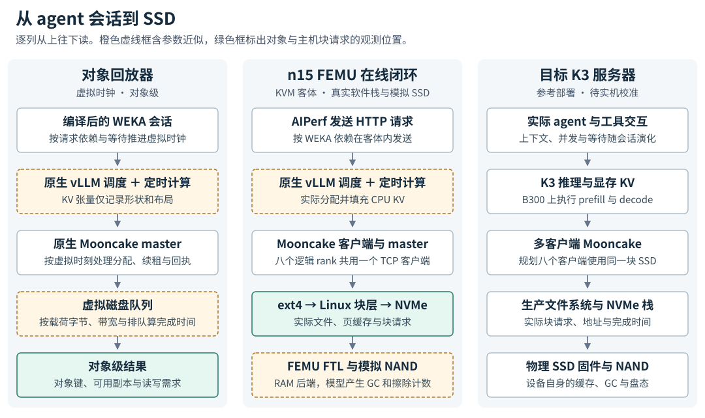
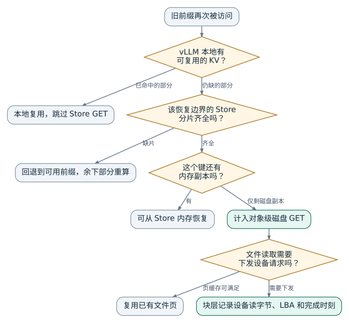
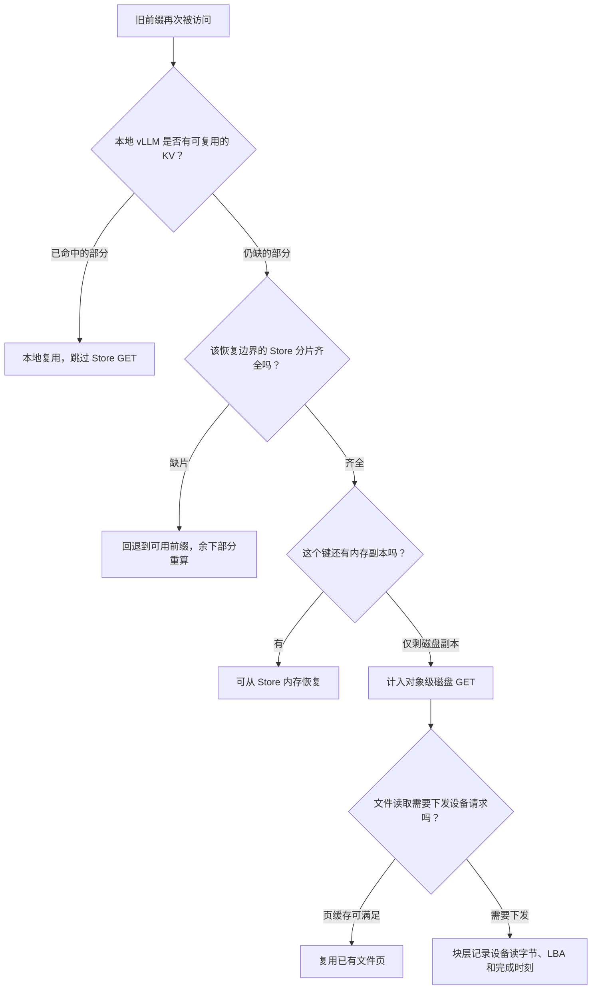

# 对象回放器、FEMU 与真实 K3 服务器的差距

截至 2026-11-23，n15。研究对象是一块承载推理 KV 缓存的 SSD。KV 是模型为了复用旧前缀而保存的状态，rank 是参与张量并行的一个逻辑工作单元。

**对象回放器能回答，在给定会话、容量和时序下，哪些缓存对象需要写盘或从盘恢复。FEMU 在线闭环能继续回答，文件系统实际向模拟 SSD 提交了哪些块请求，以及模拟闪存为此编程和搬迁了多少页。** 要把这些结果用于真实服务器，还需分别校准产生流量的服务器和接收流量的物理盘。

## 三条系统路径

左列和中列各自从会话启动，可以用同一输入独立对账。右列是项目的参考部署，容量数字来自预算。中列里，KVM 让客体 CPU 执行 Linux 和存储软件，FEMU 向这个 Linux 呈现一块 NVMe 设备。[对象回放入口](../../scripts/run_object_replay.py) · [在线闭环实现](../03-SSD负载与NAND实验/阶段C1-K3真实尺寸与容量验收.md) · [参考部署依据](../02-K3参考部署与验证/KimiK3-B300步骤2验收报告.md)

图上只画向下的请求，运行时还有反向的完成通知。旧前缀恢复完成，vLLM 才能继续依赖它的计算。保存完成，相应缓存块才可释放。左列按虚拟队列生成完成时刻，中列由实际软件传输和文件访问返回通知，需要读设备时还会等待 FEMU。

## 第一段差距 · 对象回放器与 n15 FEMU 闭环

| 环节 | 对象回放器实际做什么 | 换到 n15 FEMU 后增加了什么 |
|---|---|---|
| 请求与时间 | 按 WEKA 的前缀结构、请求长度、等待和依赖编译输入。到达和完成都是虚拟时钟上的事件。 | AIPerf 在客体内发出 HTTP 请求，项目服务实际接收和排队。CPU 准备数据、线程调度和 I/O 都占用墙钟时间。两边都使用项目 tokenizer 和合成输出。 |
| vLLM 与模型 | 运行原生 Scheduler、KVCacheManager 和 Mooncake connector。调度器实际决定分配哪些块、复用多长前缀以及何时发起保存或恢复。模型 forward 由每个计算 step 的时间预算代替。 | 仍以时间预算代替 GPU forward，但要在客体中填充真实尺寸的 CPU 缓冲区。复制和唤醒可能使 step 超出预算。n15 的 KVM 基线使用 2 vCPU、8 GiB 客体。 |
| KV 数据与布局 | 八个逻辑 rank 的张量只保存形状和步幅。原生代码照常产生 MLA 共享键、KDA 分片键及其真实字节数，主机只为回放分配元数据和运行所需缓冲。 | 为八个逻辑 rank 实际分配 CPU KV 池。内容按前缀、层和分片生成，PUT/GET 真正复制这么多字节，并可校验摘要。一个缓存对象此时有实际的数据内容。 |
| Mooncake 淘汰 | 原生 Mooncake 0.3.14 master 登记虚拟内存段，由同版本的 `BatchEvict` 选择释放的内存副本，磁盘侧也使用原生分桶与选桶代码。项目的 Python `ObjectStore` 负责安排事件、虚拟传输和记账。 | 真实后台线程看到实时的分配占用、续租和落盘回执，再执行淘汰。相同的选择代码在两个不同的时刻可以看到不同的键。 |
| 客户端与传输 | 可登记 1 个或 8 个虚拟客户端。按 rank 排保存任务，按客户端模拟内存读，多个客户端向同一条虚拟磁盘队列提交读写。 | 当前八个逻辑 worker 共用一个嵌入式 Mooncake 客户端、一个 TCP 传输端和同一 ext4 目录。线程竞争、内存复制、bucket 文件写入和回执实际发生。bucket 是 Mooncake 将多个对象合并写出的存储单位。 |
| 文件系统、块层与 NAND | 写入和恢复按对象有效载荷计数。虚拟磁盘返回对象的完成时间。 | 客体运行 ext4、页缓存、Linux 块层和 NVMe 驱动，能记录块大小、逻辑块地址（LBA）、在途数和完成时刻。FEMU 的闪存转换层（FTL）再执行地址映射、页编程和垃圾回收（GC），数据后端在宿主 RAM 中。 |

原生选键和数据搬运可以单独验证。例如，同版本 master 的 `GetReplicaList` 会处理读租约，`NotifyOffloadSuccess` 会处理落盘回执。回放器已经调用这些接口。决定它们相对淘汰轮次何时发生的时钟和队列，仍属于回放模型。[原生接口与受控验证](对象回放器-Mooncake原生淘汰.md) · [虚拟 Store](../../src/kv_ssd_sim/object_store.py) · [真实客户端与 CPU 缓冲](../03-SSD负载与NAND实验/阶段C1-K3真实尺寸与容量验收.md)

### 哪些量靠参数控制

| 参数或配置 | 控制的行为 | 怎样理解这个数 |
|---|---|---|
| `--num-blocks`、`--max-model-len`、`--clients`、`--segment-mib`、`--staging-mib`、`--quota-mib` | 本地 KV 块数、上下文上限、虚拟客户端数，以及每个客户端的 Store 内存段、暂存区和磁盘配额。 | **容量与拓扑条件。** 回放器可向原生分配器登记 TB 级逻辑容量。配置 8 个客户端只建立 8 份逻辑状态，实际传输竞争仍须校准。 |
| `--lease-ms`、`--high-watermark`、`--eviction-ratio` | 读租约时长、内存回收高水位和基础回收比例。回放按 10 ms 的原生维护周期检查压力。 | **原生策略的输入。** 本文 35 秒用例设租约 5 秒、水位 90%、基础比例 5%。master 根据当轮压力、索引、租约和引用决定实际释放量。CLI 默认租约为 0 ms。 |
| `--prefill-ms`、`--decode-ms` | 默认每个预填充、解码 step 分别预算 10 ms、2 ms。 | **计算时间近似。** 回放器推进虚拟时钟，客体在线服务按墙钟预算执行。目标机的 step 时间随 batch、上下文长度和 GPU 通信而变。 |
| `--save-ms` | 每个 rank 的一次保存任务从开始到完成的虚拟耗时，默认 1 ms。任务开始时分配，完成时才发布内存副本。 | **保存时间近似。** 参数的单位是一次 rank 保存任务。在线日志中的一次批量 PUT 有自己的起止边界，二者应按批次和键对齐后校准。 |
| `--memory-mib-s`、`--device-mib-s` | 默认每个客户端一个 8,192 MiB/s 内存读端口，所有虚拟客户端共用一条 1,024 MiB/s 的先入先出磁盘队列。 | **传输时间近似。** 对象按载荷字节、速率和排队时间得到完成时刻。1,024 MiB/s 是回放器的输入，FEMU 的块带宽由块提交和完成记录测得。 |
| `--offload-interval-ms`、`--offload-timeline` | 默认客户端每 1,000 ms 有一次领取待落盘任务的机会。也可按客户端与整桶键集合输入源查询、开始写、发布磁盘副本的时间。 | **后台时序。** 心跳间隔影响哪些对象会同时被取走。桶写完后，成功回执会解除相应源引用。用模型导出的时间表重放可以检验可重复性，标定需要同一负载的实测时间表。 |
| FEMU 的 namespace、NAND 几何、页时延和 GC 阈值 | n15 基线为 3 GiB 可见空间、4 GiB 原始 NAND、4 KiB 页。页读 40 µs、页写 200 µs、块擦除 2 ms，两个 GC 阈值参数为 75 和 95。 | **设备模型输入。** 启动器开放了 `--namespace-mib`、`--blocks-per-plane`、`--nand-read-ns` 等选项，其他若干值由启动命令固定。FTL 按模型状态产生搬迁、擦除和写放大。Mooncake 的 90% 水位管 Store 内存，FEMU 的 GC 阈值管闪存回收。 |

回放中设置的保存时间可以改变最终读盘次数。设备侧设置的页读时延也可以经 GET 完成反馈影响正在等待的请求。这两个参数分别作用于不同的软件边界。[回放 CLI 与默认值](../../scripts/run_object_replay.py) · [rank 保存实现](../../src/kv_ssd_sim/object_worker.py) · [FEMU 启动器](../../scripts/run_femu.py) · [n15 实际启动命令](../../outputs/femu-n15-0504-20261120-074735/launch.json)

## 第二段差距 · FEMU 闭环与目标服务器

| 会改变 SSD 负载的条件 | n15 已跑的 `0504` 两轮 FEMU 基线 | 项目参考服务器 |
|---|---|---|
| 会话与计算 | Claude 来源的 WEKA 会话，取两个串行父请求。项目 tokenizer 重建长度和共享前缀，模型执行采用 10/2 ms 预算。 | K3 自身的 tokenizer、实际生成和工具交互决定下一轮的 token 序列。真实 GPU 批处理、并发会话和分支影响请求抵达存储层的节奏。 |
| 本地 KV 与上下文 | 22 块/rank，上下文上限 12,288。 | 规划 1,876 块/rank，上限 131,072。实际可分给 KV 的显存仍待实机量测。 |
| Store 与 offload | 1 个实际客户端，2,520 MiB Store 段、96 MiB staging、2,840 MiB offload 配额。 | 规划 8 个客户端，各贡献 128 GB Store 段、4 GiB 磁盘 staging、375 GB offload 配额，合计 3 TB 配额，共用一块 3.84 TB 盘。 |
| 盘内状态 | 每次独立基线从新建文件系统开始，轮间保留缓存和盘态。FEMU 使用项目选定的几何与 FTL。 | 长期运行会积累有效页、失效页和磨损，物理盘采用厂商固件、缓存与预留空间。项目尚无这块目标盘的原始 NAND 容量或稳态 GC 实测。 |

**同一份输入，在两台系统上会造成不同的压力。** 两轮产生 2,402,574,336 B 唯一对象，按有效载荷相除，是 n15 offload 配额的 **80.68%**，是参考 3 TB 配额的 **0.0801%**。这是工作集与配额之比。物理页占用要从 FTL 另行读取。对象回放器已经在参考容量下运行过 5 个请求，生成约 15.55 GB 唯一对象，原生 master 记录 0 次回收轮次。这证明元数据可以在该容量下运行，读盘比例还需要能产生容量压力的会话历史。[参考容量账本](../02-K3参考部署与验证/KimiK3-B300步骤2验收报告.md) · [参考回放与 n15 逐项对照](对象回放器-Mooncake原生淘汰.md) · [n15 容量验收进度，含待验的 56 GiB 配置](../04-n15迁移与容量验收/n15-KVM基线与56GiB容量验收.md)

研究范围也会改变所说的“真实负载”。这里追踪的是推理 KV offload 给这块盘带来的流量。若生产部署还将 agent 的代码检出、编译、工具临时文件或日志放在同一块盘，整盘流量会叠加这些 I/O。公开 trace 能重建部分会话结构，真实 K3 的前缀复用距离、工具等待和并发分布仍需目标工作负载校准。[原始研究范围](../03-SSD负载与NAND实验/WEKA完整回放实施计划.md) · [输入合成与 tokenizer 审计](../KimiK3-B300步骤1验收报告.md)

## 跟一次旧前缀回读

假设 agent 过一段时间又用到旧前缀。哪一层要工作，取决于这个时刻还保留着哪些副本。图中每个判断针对所需前缀或分片。同一次请求可以一部分本地命中，另一部分恢复或重算。

查看回读路径的 Mermaid 版本

### 35 秒压力用例 · 同一套淘汰代码为何选出不同的键

这是一个**合成的旧前缀返回用例**。使用 11 块/rank、1,450 MiB Store 内存段和 5 秒租约。在线对照实际运行 n15 Mooncake，文件落在宿主机。各组请求相同的 120 个 rank/键组合，共 619,241,472 B。表中“唯盘 GET”表示 GET 发起前该键只有磁盘副本。

| 运行条件 | 回收当刻内存占用率 | 回收索引键数 | 释放的内存键数 | 唯盘 GET |
|---|---:|---:|---:|---:|
| 回放，每个 rank 保存 1 ms | 92.86% | 108 | 9 | 37 / 120 |
| 回放，仅将保存改为 10 ms | 92.86% | 72 | 6 | 20 / 120 |
| 回放，仅将保存改为 100 ms | 92.86% | 72 | 6 | 20 / 120 |
| n15 在线宿主文件实跑 | 91.46% | 72 | 5 | 12 / 120 |

1. **开始保存就占容量。** 虚拟时间 9.826 s，第三批 36 个键开始分配。9.830 s，master 检查内存压力。设为 1 ms 时，36 个键都已于 9.827 s 完成，索引里有 108 个键。设为 10 ms 时，它们要到 9.836 s 才完成，回收当刻索引里只有 72 个键。索引里的对象还要逐个检查租约和引用。
2. **哪些键会被释放，还取决于压力和保护状态。** 同样是 72 个已登记的键，回放在 92.86% 占用时触发回收，线上在 91.46% 时触发。超过 90% 水位的幅度不同，原生规则在这两轮分别选出 6 个和 5 个键。具体到每个键，后台查询写盘源副本会续租，正在进行的 offload 还会持有源引用，收到落盘回执才解除。读租约到期只是少了一层保护。
3. **总数接近也可能选错对象。** 对于 10 ms 回放，20 次唯盘 GET 与线上 12 次逐请求、rank、键匹配，只有 1 次重合，共有 30 次 GET 的层级不同。一个共享键可以被八个 rank 各读一次。这组实验定位了保存时序的影响，各键的剩余差异还需要线上分配、续租和回执时间线来解释。[原生淘汰与租约验证](对象回放器-Mooncake原生淘汰.md) · [事先冻结预测的原始对账](../../evidence/object-replay-mooncake-native-20261123/comparisons/frozen.json) · [三档保存耗时的核对数据与原始路径](../../evidence/object-replay-put-timing-20261123/summary.json)

### `0504` 设备基线 · 零次对象 GET 为何还有块读

这次实际挂载了 FEMU。第二轮在 vLLM 本地复用 11,008 个 token，两轮自然 Store GET 均为零。从首个请求发出到设备观测结束，Linux 块层仍记录了两笔标记为元数据的 4 KiB 读。三个指标各有自己的分母。

| 想知道什么 | 计算口径 | n15 的 `0504` 两轮 |
|---|---|---|
| 哪些恢复需要磁盘副本 | 唯盘 rank/键 GET 次数 ÷ 全部 Store rank/键 GET 次数 | 全部 Store GET 为 0，比例无定义。另一个 35 秒宿主用例的此项才是 12/120。 |
| SSD 收到的流量中有多少是读 | 同窗口主机块读字节 ÷（主机块读字节 ＋ 主机块写字节） | 读 8,192 B，写 2,403,450,880 B，读字节占比约 **0.00034%**。 |
| 主机写入在 NAND 上放大多少 | 同窗口 NAND 编程字节 ÷ 主机写字节。GC 搬迁产生的编程已计入分子。 | NAND 编程 2,403,450,880 B，WAF = **1**，GC 搬迁 0 B，擦除 0 次。 |

反方向也有实测例子。C1 受控恢复让八个 rank 的 120 次完整恢复全部使用磁盘副本，对象有效载荷共 **619,241,472 B**，同窗口设备完成 **182 笔、470,626,304 B** 读。共享对象会被多次请求，客体页缓存能复用已经读入的文件页。35 秒宿主用例的设备读字节仍待在同负载的 FEMU 窗口中测量。[n15 KVM 基线与三方对账](../04-n15迁移与容量验收/n15-KVM基线与56GiB容量验收.md) · [块事件原文](../../outputs/femu-n15-0504-20261120-074735/block-trace.txt) · [C1 受控恢复计数](../../evidence/ssd-c1/probe.json)

盘内还有一次转换。主机覆写一个逻辑地址时，FTL 可以把新数据写到新页，把旧页标成失效。为了擦除一个仍含有效页的块，GC 要先把这些有效页搬走，产生额外的 NAND 编程。n15 的独立 48 MiB 探针在交错覆写窗口记录到 **528,474,112 B 搬迁、2,304 次擦除**。这些量取自窗口首尾的 FTL 快照，说明即使主机写入量已知，盘的前序填充和覆写历史仍会改变 NAND 结果。[n15 原始探针和设备回放归档](../../evidence/n15-kvm-20261120-074735/) · [FTL 计数定义](../03-SSD负载与NAND实验/阶段E-NAND统计验收.md)

## 向真实服务器外推时，优先校准哪一层

| 要回答的问题 | 还缺的对照 | 对齐后能检验什么 |
|---|---|---|
| 哪些键自然读盘？ | 在同一个有压力的在线窗口，用同一时钟按 rank、键、bucket 记下 PUT 分配与完成、续租、落盘回执、回收轮次与释放键。观察副本时使用不会续租的管理接口。 | 用实测时序校准回放，再用另一段等待或并发不同的会话验证逐键层级、唯盘次数和对象字节。容量与 KV 内容仍可虚拟化。 |
| 这些对象给 SSD 带来什么块流量？ | 在 FEMU 闭环执行同一自然回读会话，保留前序缓存状态、初始盘态和后台写回窗口。将文件记录与块提交、块完成、diskstats 放在同一时间轴。 | 量出文件缓存和元数据带来的差异，并得到读写大小、地址、突发和队列深度。 |
| 目标服务器会多常进入这种状态？ | 量测 K3 在不同 batch 和上下文下的 step 时间、实际可用 KV 块、八个客户端同时保存的节奏。选择包含长会话和真实并发的样本，记录活跃工作集与容量之比，以及旧前缀再次使用前经过的其他数据量。 | 把 n15 中观测到的回读条件映射到目标服务器的会话历史，估计送往单盘的对象流量及其时间分布。 |
| 目标物理盘会发生多少 GC？ | 在相近填充度和持续替换状态下，对齐主机块请求的方向、地址、大小和到达节奏。再与目标盘可取得的写入、时延及 NAND 遥测比较。 | FEMU 给出所选 FTL 在该输入下的搬迁和 WAF。物理盘内部指标的可校准范围取决于该盘实际暴露的计数。 |
