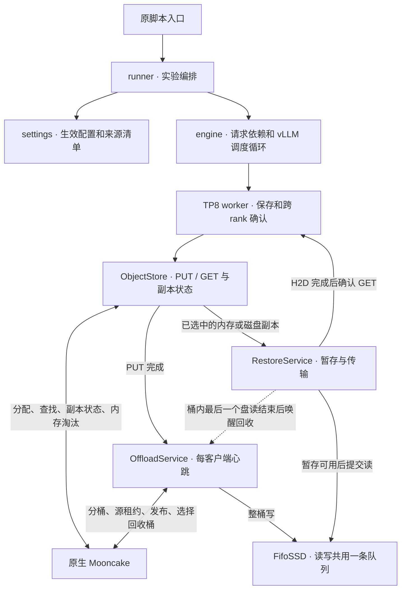

# 对象回放器重构方案与执行记录

以 Git 提交 `20316bf` 为基线，在 n15 上分步提取对象回放逻辑。研究目标是能单独改变 SSD 服务模型，并从每一个对象、每一笔桶写和每一次恢复确认解释负载差异。本轮以同输入、同配置下的等价回放验收各项改动。[基线报告](大容量单盘与两阶段KV恢复验收.md)

## 研究边界

正式配置使用 8 个 Store 客户端、1.024 TB 主存、单个 30.72 TB 逻辑设备、24 TB 文件配额。设备服务读写共用一条 FIFO，各客户端分别执行 3 TB 配额和 90% / 80% 水位。Mooncake 原生 master 决定内存分配、租约和内存淘汰，原生分桶和候选桶选择继续参与落盘与回收。在线系统使用宿主时钟，对象系统推进虚拟时钟，FEMU 的块和 NAND 指标由设备实验提供。[参考配置](../../configs/kimi-k3-b300-large-ssd.json)

基线完整预热窗口的 19,992 个写对象形成 1,208 次设备写，其中 714 次包含多个请求的对象。设备按一次桶写占用服务时间，分析按 `(io_id, key)` 保留对象的请求、rank、owner 和有效字节。SSD 读完成后文件可解除读保护，所属客户端的恢复暂存仍占用到目的 rank 的 H2D 完成。八个 rank 的全部子批恢复后才向调度器确认。[基线原始账本](../../evidence/large-ssd-staged-20261125/warm-runs.tar.xz)

## 执行顺序

| 步骤 | 代码与职责 | 通过条件 |
|---|---|---|
| 0　固定对账 | 校验旧归档，保留编译输入、配置、hash seed、原生二进制和基线。建立可重复执行的新旧输出比较 | 比较器能对上归档，能识别事件顺序或 SSD 账本的变化 |
| 1　抽出单盘 FIFO | 统一读和桶写的排队、I/O 编号、开始和完成时刻，支持记录的写入时刻。对象归因、发布与回收留在存储层 | 正式 136 请求窗口和小容量混合读写窗口逐笔一致 |
| 2　抽出恢复路径 | 由恢复模块管理 owner 暂存、源内存端口、目的 H2D 端口与 GET 完成。保留原生子批、跨 rank 确认与历史恢复模式 | 单客户端、八客户端、暂存背压及父子依赖通过 |
| 3　整理回放入口 | 请求依赖、仿真主循环、实验编排、恢复检查移入 Python 包。保留已有命令、默认配置和历史入口。运行清单覆盖实际执行的源码 | 旧入口可以重跑，同输入和配置得到相同事件、账本与审计结果 |
| 4　共享适配与在线边界 | 将对象回放与分片工具共用的 vLLM 元数据适配独立出来。物理设备策略按后续实验需要扩展 | 两个调用方都能按历史入口运行，原生测试通过。涉及客体打包或在线启动的后续变更再执行 48 MiB 探针和 3 GiB 闭环 |
| 5　拆出后台落盘 | 从 `ObjectStore` 提取每客户端的心跳、原生桶写入与发布、配额及高低水位回收。前后台共用副本状态和单盘队列 | 比较实际回收的桶、键、字节与时刻，核对回收等待期间的 GET 和新 PUT。正式窗口、自然回读及指定桶时刻逐事件一致 |

### 整仓后续计划

2026-11-26 从 `4609543` 继续。各批保留公开导入、命令行、旧配置和归档路径。研究配置沿用一块大容量逻辑 SSD、原生 Mooncake 和既有虚拟时钟。

| 顺序 | 实施范围 | 验收条件 |
|---|---|---|
| 6　工作负载与模型 | 归并 WEKA、kvlab 解析、窗口选择、输入编译及 K3 部署与 KV 几何。统一迁移所需的项目根路径 | 基线和新版对同一原始输入得到相同字节。比较父子依赖、到达与预热窗口，以及 K3 分组、分片和对象尺寸 |
| 7　存储资源 | 分离 owner 暂存与目的 rank 传输端口。让实验装配入口可指定设备，默认继续使用单盘 FIFO | 自然回读、暂存背压、同纳秒排队、旧桶读保护、父子反馈和设备替换测试通过 |
| 8　在线与 FEMU | 在线执行、原生文件 I/O 和 FEMU 客体、块与 NAND 采集归入各自包域。逐项核对客体使用的脚本及来源清单 | 实机运行原生文件恢复。重新启动 48 MiB NAND 探针和 3 GiB `0504` 两轮，验对象、块层对账和 NAND 窗口 |
| 9　配置、分析和入口 | 集中正式 profile、展开配置和来源清单，收拢流量、复用及恢复分析。提供统一 CLI，保留历史实验入口 | 用新旧入口复现确定性输出，核对旧归档校验值，正式窗口、自然回读、配额与因果用例全部对账 |

## 验收方法

| 用例 | 基线断言 |
|---|---|
| 正式单盘、136 个请求 | 全窗口 0 B 读、235,572,461,568 B 写。核对桶、键、owner 和提交、开始、完成时刻 |
| 35 秒返回、1 个客户端 | 24 次盘读、42,467,328 B。固定每次盘读、H2D 与八 rank 的完成时刻 |
| 同输入、8 个客户端 | 10 次盘读、51,603,456 B。核对各 owner 暂存和各目的 rank 的端口占用 |
| 64 MiB 受控探针 | 120 次 GET、115 次暂存等待、66,788,352 B 峰值、排空为零 |
| 合成因果后继 | 父完成后 250 ms 释放子请求。历史模式和分阶段模式之间，父完成及子到达、接纳、完成均相差 95,304 ns |

比较相同配置的运行时，核对虚拟事件的原有行序与纳秒时间，包括同纳秒的原生维护、外部事件入队顺序和前台结束后的后台排空。SSD 压缩账本按解压后的内容核对。运行清单中的源码路径、哈希、输入所在目录以及宿主实测 RSS 按各自含义核实。每次试验使用独立输出目录；历史证据与清单按原版本读取。[归档清单](../../evidence/large-ssd-staged-20261125/SHA256SUMS)

## 分步执行结果

2026-11-25 在 n15 使用独立分支 `refactor/object-replay`。表内目录位于 `.object-replay-build/trials/refactor-BllpJxZA/`。宿主保留原始事件和新试验输出，Git 中保存基线归档和本轮核对摘要。

| 步骤 | 本地提交 | 运行与结果 |
|---|---|---|
| 0　通过 | `45df958` | 两份旧归档的校验清单通过。重新运行 35 秒样本，`00-baseline/` 与归档相符。分别交换 0 ns 的两条事件、同一桶同一提交时刻的两条 SSD 记录，比较器均检出 |
| 1　通过 | `8024b6b` | `01-device/` 的单客户端自然读和正式 136 请求全窗逐事件、逐笔 SSD 服务、逐请求相同。17 项对象回放测试通过 |
| 2　通过 | `f8d22b2` | `02-restore/` 对齐单端、八端、暂存背压、历史恢复和两种父子夹具。探针报告与原始事件逐字节相同。父子配对报告与归档相同，17 项对象回放测试通过 |
| 3　通过 | `7f78ec0` | `03-runner/` 由旧脚本入口重跑正式窗口及两种恢复模式。另从 `20316bf` 导出源码，核对省略 profile 时的 n15 默认输出和 CLI 帮助。普通 Python 可从旧归档重算恢复审计。117 项既有非集成测试通过 |
| 4　通过 | `986538d` | `04-final/` 验证对象路径。`04-native-shards/` 从宿主真实 Store 文件恢复，36 个唯一对象的有效载荷共 470,605,824 B，逐键载荷 SHA-256 与旧分片探针相同。120 次跨 rank 恢复共 619,241,472 B。原生证据检查通过，6 项回环 TCP 集成测试通过 |
| 兼容性回归通过 | `bb57494` | 原脚本继续导出请求依赖、仿真、profile 和恢复审计符号。新增两个同时间戳顺序测试，同时验证 gzip 头时间戳变化可正常对账。全套非集成测试共 119 项通过 |

最终代码跑完四组 136 请求矩阵，1×、4×、8× 与 3 TB 对照各自的事件和逐键账本都与相应归档一致，整份四组汇总也逐字节相同。主配置全窗测得 1,208 笔桶写、19,992 个唯一写对象、235,572,461,568 B 写和 0 B 读。独立自然返回用例仍为单客户端 24 次盘读和八客户端 10 次盘读。64 MiB 暂存探针复现 115 次等待、66,788,352 B 峰值以及最终零占用。前述阶段的进程分别重新启动，输出保存在独立目录。

最终验收逐项比较了 11 对运行，包括原四组矩阵、五组恢复与因果用例、省略 profile 的默认入口，以及使用相同 `--offload-timeline` 的新旧运行。n15 保留的基线完整目录还提供了 `objects.json` 和 `reuse.jsonl`，两项也参加对账。所有最终运行清单记录的源码哈希逐文件与实施提交核对。归档列出各输出摘要、受控探针、原生分片及历史 NAND 报告校验值。[本轮机器可读验收记录](../../evidence/object-replay-refactor-20261125/verification.json) · [校验清单](../../evidence/object-replay-refactor-20261125/SHA256SUMS) · [非集成测试](../../evidence/object-replay-refactor-20261125/tests.log) · [原生测试](../../evidence/object-replay-refactor-20261125/native-tests.log)

真实分片探针的完整事件中有 **135 次**仅磁盘副本的 GET 完成。前 15 次用于 rank 0 校验，后 120 次覆盖完整的八 rank 恢复。本轮设备层验收从旧 QMP、客体标记和块 trace 重新生成两份 NAND 报告，48 MiB 探针和 3 GiB 的 `0504` 报告均逐字节对上。此次实际新运行的是对象回放和宿主原生文件实验。新的 FEMU 设备采样随客体打包、在线启动或设备实现的后续变更执行。[原设备基线](../04-n15迁移与容量验收/n15-KVM基线与56GiB容量验收.md)

### 步骤 5 · 后台落盘与磁盘回收

2026-11-26 在 n15 以 `4869c1d` 为拆分前基线，实施提交为 `a84c944`。`ObjectStore` 完成 PUT 后，将对象和请求来源交给 `OffloadService`。它按文件所属客户端发起心跳，向 Mooncake 领取任务、取得原生分桶和源副本租约。每个桶在共享盘上提交一次写入，写完后向原生 master 发布各键的磁盘副本。写入空间不足或心跳结束超过高水位时，由原生文件后端选择回收桶。回放器负责虚拟容量、服务时间及在途读取保护。[后台落盘](../../src/kv_ssd_sim/simulation/storage/offload.py) · [原生接口](../../native/object_replay_master.cpp)

| 验收窗口 | 拆分前后相同的结果 |
|---|---|
| 136 个请求，正式大容量单盘、默认带宽 | 19,992 个唯一写对象，1,208 笔桶写共 235,572,461,568 B，其中 714 笔包含多个请求的对象。全窗读 0 B，磁盘桶回收 0 个 |
| 35 秒后返回，单客户端与八客户端 | 自然盘读分别为 24 次、42,467,328 B 和 10 次、51,603,456 B。每笔读、目的 rank 的 H2D 完成和请求完成时刻均一致 |
| 同一返回输入，单客户端 768 MiB 配额 | 三次在下一笔桶写前腾出空间，共回收 3 个完整桶、57 个对象、762,080,256 B。最终占盘 655,045,632 B，盘读 0 B |
| 同一返回输入，单客户端 1,450 MiB 配额 | 峰值占盘 1,411,817,472 B，低于硬配额。心跳末越过 90% 高水位，回收 1 桶、18 个对象、252,257,280 B 后回到 80% 以下。下一轮写完后最终占盘 1,164,868,608 B，盘读 0 B |

后两组仅调整 2,840 MiB 对照中的单客户端磁盘配额，使两种回收触发条件都能在同一输入上观察。回收字节按被移除的对象有效载荷计量。盘内页搬迁、擦除和写放大另由 FEMU 采样。[两组拆分前的逐键账本](../../evidence/object-offload-refactor-20261126/reclaim-baselines.tar.xz)

在双读者测试中，旧桶两个对象分别在第 1、2 ms 完成盘读，整桶在第 2 ms 回收。第 1 ms 到达的新 PUT 随下一次心跳处理，两个新对象依次在第 3、4 ms 发布，旧对象的 H2D 继续到第 11、12 ms。这项测试连同记录时刻的完整性检查也在冻结的旧源码上通过。[边界测试](../../tests/test_object_replay.py)

本步共核对 13 对完整回放。四组正式窗口、五组恢复和父子用例、默认 n15 入口、指定桶时刻、两组小配额试验均验证了同一纳秒内的事件行序、逐桶时刻、SSD 逐键账本、最终副本与复用记录。另行核对了 64 MiB 受控探针的完整事件和报告。候选运行清单中 29 个源码文件的 SHA-256 均与实施提交相符。120 项非集成测试、6 项本机回环 TCP 原生集成测试通过。原始试验位于 n15 的 `.object-replay-build/trials/refactor-offload-U6uPBB1T/`。[逐用例验收与哈希](../../evidence/object-offload-refactor-20261126/verification.json) · [校验清单](../../evidence/object-offload-refactor-20261126/SHA256SUMS) · [非集成测试](../../evidence/object-offload-refactor-20261126/tests.log) · [原生集成测试](../../evidence/object-offload-refactor-20261126/native-tests.log)

对照整体重构方案，设备服务、恢复和后台落盘已各有入口。暂存与 H2D 在 `RestoreService` 中协调。后续可独立迁移 WEKA/kvlab 工作负载的解析与编译，并以编译输入哈希、父子依赖及请求到达时刻验收。在线运行和 FEMU 启动入口的迁移另以原生文件与设备闭环验收。

## 实施后的代码路径



单盘模块为每笔服务分配 `io_id`，返回开始和结束时刻。调用方按原顺序将读完成、发布等回调送入虚拟时钟。桶中不同请求的对象分别记录来源。内存命中的 GET 占用源客户端内存读端口和目的 H2D 端口。磁盘命中在盘读完成后进入目的 H2D 队列。[单盘服务](../../src/kv_ssd_sim/simulation/storage/device.py) · [恢复路径](../../src/kv_ssd_sim/simulation/storage/restore.py) · [虚拟时钟](../../src/kv_ssd_sim/simulation/clock.py)

回放入口和离线审计都可以从包内调用。命令行保留 `scripts/run_object_replay.py` 和 `scripts/check_staged_restores.py`，省略 profile 时使用 n15。来源清单由运行时和事后归档共用。真实分片探针和对象 worker 引用同一个 vLLM 元数据规划函数，老的 `k3_online.metadata_rank_worker` 导入仍可用。[回放编排](../../src/kv_ssd_sim/simulation/runner.py) · [请求依赖与执行](../../src/kv_ssd_sim/simulation/engine.py) · [恢复审计](../../src/kv_ssd_sim/analysis/restore.py) · [来源清单](../../src/kv_ssd_sim/simulation/provenance.py) · [共享分片适配](../../src/kv_ssd_sim/adapters/vllm.py)

## 在 n15 复现

以下命令从阶段 05 已使用的原生环境运行，输入直接取自 Git 中的归档。正式窗口使用 `PYTHONHASHSEED=0`，自然返回沿用夹具的未设置状态。探针入口为它自己的键生成器固定种子 42。运行脚本为每组检查选用对应设置。[环境构建脚本](../../scripts/reproduce_kvlab_n15.sh) · [逐用例运行入口](../../scripts/reproduce_replay_refactor.sh)

```bash
cd /home/yzh/projects/kv-ssd-sim
source .object-replay-build/trials/kvlab-20261124/env.sh
study=$(mktemp -d "$PWD/.object-replay-build/trials/refactor-XXXXXXXX")
ev=evidence/large-ssd-staged-20261125
prev=evidence/tp8-logical-volume-20261125
(cd "$ev" && sha256sum --quiet -c SHA256SUMS)
(cd "$prev" && sha256sum --quiet -c SHA256SUMS)
mkdir "$study/fixtures"
tar -xJf "$ev/restore-runs.tar.xz" -C "$study/fixtures"
tar -xJf "$ev/warm-runs.tar.xz" -C "$study/fixtures"
xz -dc "$prev/warm-input.json.xz" > "$study/fixtures/inputs/warm.json"
REPLAY_PYTHON="$py" bash scripts/reproduce_replay_refactor.sh "$study/fixtures" "$study/check" \
  warm base-staged tp8-pressure probe matched-legacy child-staged child-legacy
"$py" scripts/compare_restore_paths.py "$study/check/child-legacy" "$study/check/child-staged" \
  > "$study/child-paired.json"
cmp "$ev/child-paired.json" "$study/child-paired.json"
```

另可由已有矩阵入口完整运行 1×、4×、8× 服务率及 3 TB 配额对照。比较器检查每组的实际生效设置、有序事件、请求结果、分桶、解压后的 SSD 账本、摘要和恢复结果。`--source-root` 逐项校验候选运行清单中的新源码哈希。[等价性比较器](../../scripts/verify_replay_equivalence.py)

```bash
mkdir -p "$study/matrix-input/warm"
ln -s "$study/fixtures/inputs/warm.json" "$study/matrix-input/warm/input.json"
cp "$prev/warm-window.json" "$study/matrix-input/warm/window.json"
PYTHONHASHSEED=0 "$py" scripts/run_kvlab_matrix.py "$study/matrix-input" \
  --window warm --output "$study/matrix"
for sample in volume-1x volume-4x volume-8x single-3tb; do
  "$py" scripts/verify_replay_equivalence.py "$study/fixtures/warm/$sample" \
    "$study/matrix/warm/$sample" --source-root .
done
"$py" scripts/compare_volume_replay.py "$study/matrix/warm" \
  --window "$study/matrix-input/warm/window.json" > "$study/warm-comparison.json"
cmp "$ev/warm-comparison.json" "$study/warm-comparison.json"
```

默认 n15 入口和观测时刻输入可以直接与基线源码配对。两个版本使用同一份固定原生二进制、wheel 和编译输入。下列命令沿用前文环境准备得到的 `py` 和 `pkg`。

```bash
baseline="$study/checkout-20316bf"
mkdir "$baseline"
git archive 20316bf -- src scripts configs native references/kimi-k3-b300/model-config.json \
  datasets/kimi-k3-b300-step1/slice.json | tar -x -C "$baseline"
export KV_SSD_OBJECT_MASTER_DIR="$PWD/.object-replay-build"
unset PYTHONHASHSEED
input="$study/fixtures/inputs/return-idle.json"
for mode in default timeline; do
  flags=()
  if [[ $mode == timeline ]]; then
    flags=(--profile reference --clients 1 --num-blocks 11 --max-model-len 12288
           --segment-mib 1450 --staging-mib 96 --quota-mib 2840
           --offload-timeline "$study/fixtures/runs/base-staged/bucket-timing.jsonl")
  fi
  PYTHONPATH="$baseline/src:$pkg" "$py" "$baseline/scripts/run_object_replay.py" \
    "$input" "${flags[@]}" --output "$study/$mode-before"
  "$py" -m kv_ssd_sim.simulation.runner "$input" "${flags[@]}" --output "$study/$mode-after"
  "$py" scripts/verify_replay_equivalence.py "$study/$mode-before" "$study/$mode-after" --source-root .
done
```

以下两项原生检查需要本机回环 TCP，分片探针使用新目录中的宿主文件。FEMU 归档可在单独目录解包后运行 `scripts/analyze_nand.py`，与解包时保存的 `nand-report.json` 逐字节比较。[分片证据检查器](../../scripts/check_k3_shard_evidence.py) · [NAND 基线归档](../../evidence/n15-kvm-20261120-074735/)

```bash
"$py" -m pytest -q -m 'not integration'
"$py" scripts/verify_k3_shards.py --output "$study/native-shards"
"$py" scripts/check_k3_shard_evidence.py "$study/native-shards"
KV_SSD_RUN_NATIVE_TESTS=1 "$py" -m pytest -q -m integration tests/test_integration.py
```

### 单独复现步骤 5 的两组磁盘回收

以下命令使用 Git 中的返回输入和两份由 `4869c1d` 产生的基线。它会在新目录运行当前实现，逐项比较有效配置、有序事件、设备账本及最终副本状态。配额单位均为 MiB。

```bash
cd /home/yzh/projects/kv-ssd-sim
source .object-replay-build/trials/kvlab-20261124/env.sh
work=$(mktemp -d "$PWD/.object-replay-build/trials/offload-check-XXXXXXXX")
ev=evidence/object-offload-refactor-20261126
(cd "$ev" && sha256sum --quiet -c SHA256SUMS)
mkdir "$work/fixtures"
tar -xJf evidence/large-ssd-staged-20261125/restore-runs.tar.xz \
  -C "$work/fixtures" inputs/return-idle.json
tar -xJf "$ev/reclaim-baselines.tar.xz" -C "$work/fixtures"
REPLAY_PYTHON="$py" bash scripts/reproduce_replay_refactor.sh \
  "$work/fixtures" "$work/runs" quota-768 quota-1450
```
