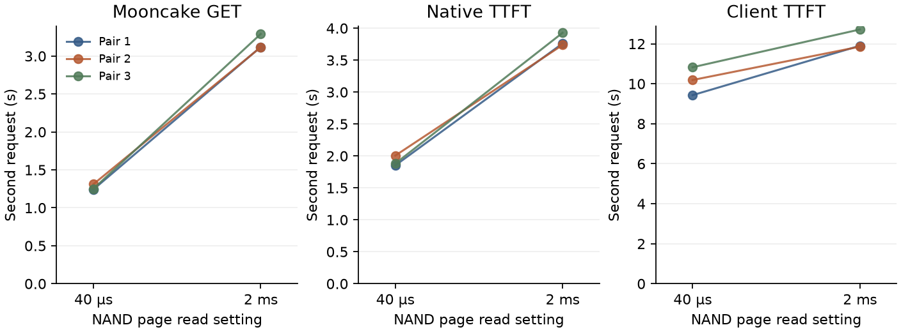

# 步骤 6 · 真实 WEKA 两轮在模拟 SSD 上的重复对照

2026-11-18。**本机缩放配置的步骤六通过。** 六个成功客体均完成真实切片的两轮请求。将 NAND 页读从 40 µs 改成 2 ms 后，第二轮 AIPerf 原始 TTFT 的配对差值中位数为 **+1.89 s**。三个配对的设备平均读时延、GET、原生 TTFT 和客户端 TTFT 均增加。结果适用于实际测量的 TP1 混合缓存和 TCG 客体。K3 真实尺寸 TP8 的在线切片与 B300 实机性能仍待验证。[汇总数据](../evidence/kimi-k3-step6/summary.json) · [原始证据](../evidence/kimi-k3-step6/trials.tar.gz)

## 配对结果

每格为快读 → 慢读，时延来自出现磁盘命中的第二轮。第 2 对按慢 → 快顺序执行。

| 配对 | 块读平均时延（ms） | Mooncake GET（s） | vLLM 首 token（s） | 客户端首 token（s） | 客户端慢减快（s） |
|---|---:|---:|---:|---:|---:|
| 1 | 0.100 → 2.342 | 1.24 → 3.12 | 1.85 → 3.76 | 9.43 → 11.90 | +2.47 |
| 2 | 0.098 → 2.344 | 1.31 → 3.12 | 2.01 → 3.74 | 10.19 → 11.85 | +1.67 |
| 3 | 0.098 → 2.448 | 1.25 → 3.29 | 1.88 → 3.93 | 10.82 → 12.71 | +1.89 |



以下统计为三次运行的中位数 [最小值, 最大值]。计算窗口和计算预算均覆盖该请求的 prefill 及所有 decode steps。

| 指标 | 40 µs | 2 ms |
|---|---:|---:|
| 第 1 轮客户端首 token（s） | 19.61 [18.98, 21.83] | 21.18 [19.81, 22.10] |
| 第 1 轮客户端请求完成（s） | 21.40 [20.39, 23.30] | 22.83 [21.32, 23.73] |
| 第 1 轮入队前占位数据准备（s） | 7.61 [6.97, 8.94] | 8.18 [7.50, 9.43] |
| 第 1 轮实际计算窗口（s） | 7.92 [7.85, 8.05] | 7.97 [7.97, 8.11] |
| 第 1 轮计算超预算量（s） | 2.02 [1.94, 2.14] | 2.07 [2.07, 2.20] |
| 第 2 轮客户端首 token（s） | 10.19 [9.43, 10.82] | 11.90 [11.85, 12.71] |
| 第 2 轮客户端请求完成（s） | 11.68 [10.89, 12.32] | 13.36 [13.36, 14.27] |
| 第 2 轮入队前占位数据准备（s） | 7.40 [6.84, 8.17] | 7.36 [7.36, 7.99] |
| 第 2 轮实际计算窗口（s） | 1.09 [1.06, 1.09] | 1.09 [1.05, 1.09] |
| 第 2 轮计算超预算量（s） | 0.37 [0.34, 0.37] | 0.37 [0.33, 0.37] |
| 第二轮冷准备（s，发送前） | 0.90 [0.83, 0.97] | 0.91 [0.85, 0.93] |
| 第二轮 GET 窗口块读次数 | 1,080 [1,063, 1,082] | 1,043 [1,040, 1,066] |
| 第二轮 GET 窗口块读量（MiB） | 11.80 [11.78, 11.82] | 11.75 [11.68, 11.83] |
| 全记录窗口块读次数 | 1,083 [1,066, 1,085] | 1,046 [1,043, 1,069] |
| 全记录窗口块读量（MiB） | 11.82 [11.80, 11.84] | 11.77 [11.70, 11.85] |
| 全记录窗口块读平均完成时延（ms） | 0.099 [0.098, 0.101] | 2.344 [2.342, 2.448] |
| 全记录窗口块写次数 | 99 [96, 103] | 102 [101, 103] |
| 全记录窗口块写量（MiB） | 13.73 [13.68, 13.73] | 13.77 [13.74, 13.77] |
| 全记录窗口块写平均完成时延（ms） | 1.140 [1.130, 1.145] | 1.137 [1.119, 1.195] |

两轮各自的固定计算总预算均跨组相同，分别为 5.906 s 和 0.720 s。客户端 TTFT 包含服务端构建长提示和占位摘要的开销，这部分在 vLLM 入队前发生。GET 的变化应与块读次数和读量一起解释：应用层对象完全匹配，但原生存储的桶布局和操作系统的块请求划分允许有波动。全窗口读写还包括文件系统元数据，不能换算 NAND 内部写放大。

本机 WSL2 有 28 个可见逻辑 CPU、约 15.5 GiB 内存。五次由重复运行脚本启动的客体，其启动器及子进程最大 RSS 为 3.11–3.16 GiB；第一组快读直接启动，没有采集峰值 RSS。完整测试启用原生集成后 81 项通过；步骤 4 和 5 的既有归档重新验算通过。

## 实验口径

实验使用项目已审计的 Claude Code WEKA 会话 `trace_0001` 的前两轮。原文件有 41 条父请求，本次选择会话开头的连续两条，保留原始输入和输出长度、前缀 hash、父轮次依赖和 12 s think time。AIPerf 0.13.0 在合成 tokenizer 上重建请求。源码、文件 SHA256 和逐条选择依据见[输入审计](KimiK3-B300步骤1验收报告.md)。

延续本机缩放方案，每轮都运行 AIPerf HTTP 客户端、原生 vLLM 调度器与 KV 块管理、MooncakeStoreConnector、Mooncake embedded real client 及 FEMU BlackBox。缓存采用 TP1 的一层 MLA、一层 KDA，64-token 块，4,096 个物理块（CPU KV 池 32 MiB），上下文上限 81,920，每 step 最多 128 tokens。prefill/decode 预算为 10/2 ms，关闭 receiver 延迟注入。客体为 2 vCPU、4 GiB，单盘 namespace 384 MiB，TCG 软件虚拟化，无 GPU forward。[混合缓存配置](../configs/hybrid-tiny.json) · [目标 K3 规格](KimiK3-B300步骤2验收报告.md)

每次用新的客体、文件系统和 Store。第一轮结束并经过 trace 指定的等待后，在第二轮的 HTTP 发送前完成落盘确认、内存驱逐、前缀重置与客体页缓存清理。客户端首 token 时延采用 AIPerf 原始计时，包含 HTTP 解析、长提示占位数据准备、入队、GET、计算及首 token 返回。人工冷准备另计。步骤 5 的自然淘汰路径有单独证据，本次研究的是已经发生磁盘恢复时，NAND 变慢如何传到客户端。

以 40 µs 和 2 ms 作为 NAND 页读参数，固定顺序为快慢、慢快、快慢。两值均为实验干预。以请求、软件、计算预算、调度 token 数、逻辑对象键、尺寸和摘要匹配各次运行；文件系统分配、读合并、readahead 和块层实际读量属于观测结果。三组配对报告逐次值、中位数和极差，未据此估计生产环境 P95/P99。

## 请求与对象

| 源轮次 | 输入 / 输出 tokens | 外部恢复 tokens | 实际计算的 prompt tokens | 新写 MLA | 新写 KDA |
|---|---:|---:|---:|---:|---:|
| 第一轮 | 71,175 / 169 | 0 | 71,175 | 1,112 个，9,109,504 B | 1,112 个，2,917,888 B |
| 第二轮 | 72,762 / 296 | 71,168 | 1,594 | 24 个，196,608 B | 24 个，62,976 B |

第二轮 GET 共读取 1,113 个仅磁盘对象，包含 1,112 个 MLA 块（9,109,504 B）和共享前缀边界处的 1 个 KDA 快照（2,624 B）。虽然第一轮为多个位置写过 KDA，恢复这一前缀只需要最后一个对应的快照。对象有效读取合计 9,112,128 B。该数值针对当前 64-token 块的 tiny 配置；K3 目标的 Store 单位及每个对象的字节数不同。

## 10 ms 页读失败样本

第一次慢读采用 10 ms。两个请求的 HTTP 响应头均返回 200；第二轮在流中没有交付有效内容。Mooncake 日志给出暂存缓冲区 GC TTL 为 5,000 ms，本地批量取回 1,113 个对象用时 10,103 ms，全部返回 -706（`OBJECT_HAS_LEASE`），客体退出码为 1。该超时来自 SSD offload 暂存缓冲区，与步骤 5 的 master 对内存对象的读取租约是两个参数。此轮保留为失败观测，未将失败请求的耗时填成 TTFT。正式慢读改用 2 ms，保留相同的 5 秒 TTL；首个 40 µs 基线复用原始运行。因此按实际时间顺序，第一对快、慢样本之间还有一次 10 ms 失败试探。[失败记录](../evidence/kimi-k3-step6/failed-10ms.json) · [失败试验原始日志](../evidence/kimi-k3-step6/failed-10ms.tar.gz)

## 复现

项目根目录下可运行完整的六个客体。每次使用新前缀，`--resume` 可验证并复用该前缀下已完成的试验；不覆盖失败目录。

```bash
.venv/bin/python scripts/run_step6.py --prefix femu-step6-repeat
.venv/bin/python scripts/analyze_step6.py outputs --prefix femu-step6-repeat \
  --output outputs/step6-repeat-summary.json
.venv-aiperf/bin/python scripts/plot_step6.py outputs/step6-repeat-summary.json \
  outputs/step6-repeat-latency.png
```

原始验收材料保留客户端原始包与指标、服务器事件和运行清单、主客体输入回执、块设备跟踪、串口与退出码。离线核对无需启动虚拟机。

```bash
(cd evidence/kimi-k3-step6 && sha256sum -c --quiet SHA256SUMS)
mkdir -p outputs/step6-offline
tar -xzf evidence/kimi-k3-step6/trials.tar.gz -C outputs/step6-offline
.venv/bin/python scripts/analyze_step6.py outputs/step6-offline --prefix femu-step6 \
  --output outputs/step6-offline/summary.json
cmp evidence/kimi-k3-step6/summary.json outputs/step6-offline/summary.json
```
